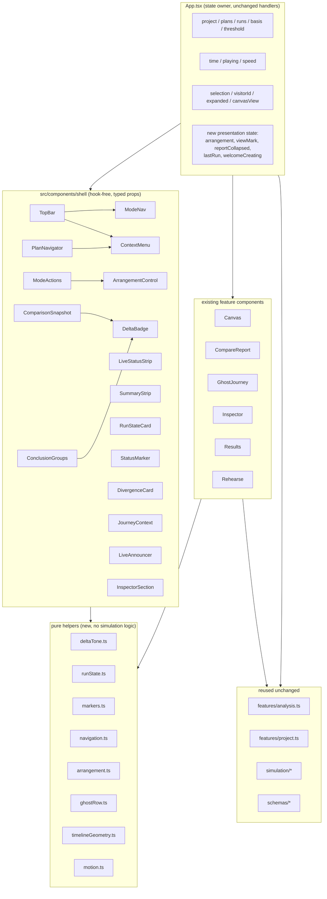
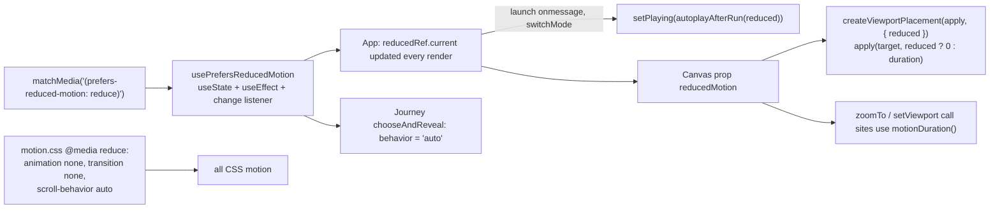
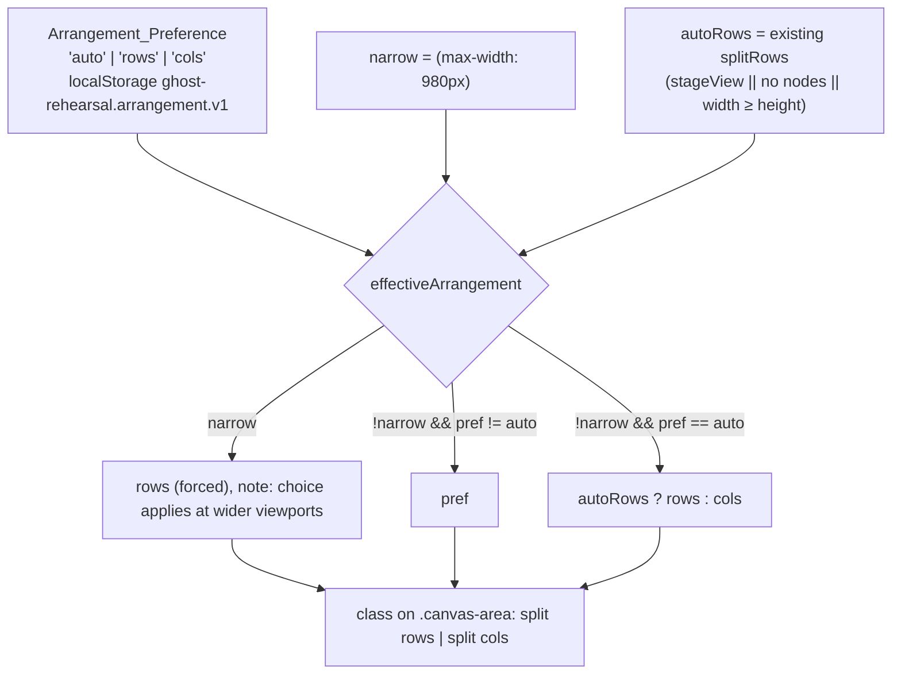
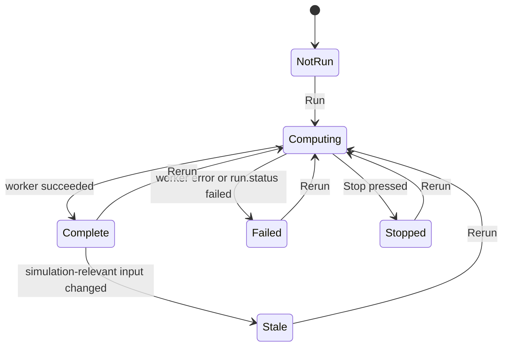

# Design Document

## Overview

Rehearsal Studio UI is a presentation, layout, interaction-organization and copy overhaul of the Ghost Rehearsal workbench (React 19 + `@xyflow/react` 12 + Vite 8, no UI framework). The target is a dark, precise "ghost rehearsal control room" in which simulated crowd flow and the diverging fates of the same guests are the visual subject.

The design keeps `src/simulation`, `src/schemas` (including the fingerprint), `src/features/analysis.ts`, `src/features/project.ts` and the saved-project formats untouched. All new logic is presentation logic: visual tokens, component structure, copy, three approved new behaviors, and a few pure helpers that classify or lay out values that already exist.

### What this design changes, in one table

| Area | Baseline (verified in code at `40dc58d`) | Design |
| --- | --- | --- |
| Styles | One 1,660-line `src/app/styles.css`, one radius and one shadow token, many hard-coded greys and lengths, 9–11.5 px auxiliary text, `!important` on four lines | Eight CSS files in explicit `@layer`s, complete token set, token-only values, ≥12 px text, `!important` only for xyflow selectors and the reduced-motion rule |
| Colors | Mint is Plan A, but also "done" state (`--st-done`) and gain delta (`.delta.good`); orange is used for the brand, waiting state (`--st-wait`), changed edges and `.btn.accent` | Orange: brand and primary action only. Mint = Plan A, purple = Plan B, nothing else. Status and delta tones get their own tokens and a `StatusMarker` (text + icon + shape + tone) |
| `App.tsx` | One 85 KB component that renders top bar, sidebar, strips, dock and 14 dialogs inline | State and handlers stay. About a dozen hook-free presentational components move to `src/components/shell/` |
| Top bar | No activity/plan context, save state lives in the sidebar | Context chip (activity · plan A), save-state indicator beside Save, disabled-reason text, assertive/polite announcer |
| Plan navigator | Rename, remove, duplicate, set-B, template buttons always visible | Plan list with A/B badges; secondary actions move into a keyboard-operable context menu; rail keeps badges |
| Canvas | `Fit` and `Overview` buttons without active state, decorations at full strength, 300 ms viewport animation always | Active-view marker, quiet decorations on working canvases, `duration` forced to 0 under reduced motion |
| Rehearse | Two metric groups in a tall strip, dock opens at a fixed height | Single-row live status and summary strips with separate titles, dock height budget tied to viewport height |
| Two Futures | Verdict paragraph, inline zh/en strings, automatic stacking only | Comparison Snapshot with five rows, three conclusion groups, inline strings moved to `messages.ts`, arrangement control |
| Journey | Lanes, states, divergence in that order | Order fixed by Requirement 22.1: guest, states and outcome, divergence card, shared-axis lanes, station table, raw events |
| First run | Welcome is the `EventCreator` modal; "try the demo" is a small link at the bottom of a long form | Same modal and same `Modal` focus logic. New lead sentence (copy), demo and import promoted to the top by CSS `order`, full-strength decorations behind it |

### Findings from reading the code that shape the design

These are facts that the requirements assume or that the design must respect. Each one is checked against source, not inferred.

1. **Unit tests render the real `App` through a hook shim.** `tests/workbench.test.ts` replaces only `useState`, `useRef`, `useMemo`, `useEffect`, `useCallback` and `useContext`, calls `App()` and flattens the returned element tree through `props.children`. It does **not** expand function components. Anything extracted from `App.tsx` would disappear from that tree. Design response: every extracted shell component is hook-free apart from `useI18n` (which is `useContext`), and the test helper `flatten` is extended to expand components registered in `SHELL_COMPONENTS` by calling them as functions. This changes a selector helper, not an assertion (Requirement 4.5).
2. **The shim has no `useSyncExternalStore`, `useLayoutEffect`, `useId` or `useReducer`, and `window` is stubbed to `{ addEventListener, removeEventListener }`.** `window.matchMedia` is absent in tests. New hooks (`usePrefersReducedMotion`, `useNarrowScreen`) are therefore built from `useState` and `useEffect` only and use `window.matchMedia?.(...)`, exactly like the existing `App.tsx` line `window.matchMedia?.('(max-width: 980px)')?.matches`.
3. **Mode ids are `'Build' | 'Rehearse' | 'Compare'`.** "Two Futures" is only the label (`t.modes.Compare`). Class names (`mode-compare`, `focus-person`, `mobile-*`) and test lookups use these ids, so they are not renamed.
4. **e2e and unit tests depend on class names:** `.outcome-table`, `.people-stats b`, `.people-list .people-result`, `.people-count`, `.ghost-id code`, `.diff-note`, `.bin-count`, `.evidence-card`, `.pair-groups b`, `.resource-comparison`, `.report-plans b`, `.comparison-identities`, `.is-report .statistics-scope`, `.journey-header button`, `.ghost-stories input[type=search]`, `.workspace-menu > summary`. They are the **test contract** (section "Test contract classes"); extracted components keep them. `getByRole('dialog')` plus `t.eventSetup.demo` and `t.common.closeDialog` are also relied on for the welcome screen.
5. **`workbench.test.ts` finds buttons by exact text** (`text(item) === label`). A button's text content must stay exactly its label; extra explanatory text goes into `aria-describedby` targets outside the button.
6. **`Dialogs.tsx` and `Inspector.tsx` belong to task B.** The welcome screen is `EventCreator` inside `Modal`, and the Inspector has no collapsible sections. The design therefore reaches the welcome goals through copy (`messages.ts`) and CSS, and limits Inspector work to wrapping existing field groups in `<details>` (layout only, applied last).
7. **Card outer sizes are load-bearing.** `NODE_SIZE` (200×118 build, 200×196 run), `STAGE_SIZE` (236×196) and `FRAME_PAD` feed `displayLayout`, `frameBoxes`, `arrangeLayout` and the viewport math, and `tests/stages.test.ts` and `tests/canvas.test.ts` must pass unchanged. The design keeps the outer boxes and reorganises the inside of the cards.
8. **The comparison "Snapshot" already exists** as a local component in `CompareReport.tsx`, but it covers only completed count, average wait and resource cost, and the `Verdict` paragraph duplicates it. The people-group buttons already exist (`.people-stats`) for three groups plus two text buttons for rescued/lost.
9. **Replay and statistics scope are already two state values** (`time` and `basis`). Separation is a presentation matter (two titled regions) plus tests, not a state refactor.
10. **Reduced motion today:** CSS animation and transition are disabled by one `@media` rule, `Journey.tsx` picks non-smooth `scrollIntoView`, but replay still auto-plays after a run (`setPlaying(true)` in `launch` and `switchMode`) and `setViewport` always animates (`createViewportPlacement` requests 300 ms).

### Research summary

| Question | Finding | Used for |
| --- | --- | --- |
| Can layered CSS coexist with third-party stylesheets? | Unlayered declarations beat layered ones regardless of specificity or order ([MDN `@layer`](https://developer.mozilla.org/en-US/docs/Web/CSS/@layer)). `main.tsx` imports `@xyflow/react/dist/style.css` unlayered, so it would override our layers. | Import xyflow CSS into a lowest `vendor` layer with `@import ... layer(vendor)` and drop the JS import |
| Reduced motion semantics | `prefers-reduced-motion: reduce` is a user request for minimal non-essential motion ([MDN](https://developer.mozilla.org/en-US/docs/Web/CSS/@media/prefers-reduced-motion), [WCAG 2.3.3](https://www.w3.org/WAI/WCAG22/Understanding/animation-from-interactions.html)). Auto-playing replay is moving content that the user did not start. | Replay paused by default, manual play allowed, animation, transition and smooth scroll off |
| Viewport animation in React Flow | `setViewport`, `setCenter`, `fitBounds` and `zoomTo` take a `duration` option; omitting it jumps without animation ([xyflow discussion #5077](https://github.com/xyflow/xyflow/discussions/5077), [React Flow docs](https://reactflow.dev/learn)). `Controls` calls `zoomIn()`/`zoomOut()` without options. | One `motionDuration(reduced, ms)` helper in front of every call; browser test samples the viewport transform |
| Touch target size | WCAG 2.5.5 (AAA) asks for 44×44 CSS px; 2.5.8 (AA) asks for 24×24 ([Understanding 2.5.5](https://www.w3.org/WAI/WCAG22/Understanding/target-size-enhanced.html)). Hit areas can exceed visuals if neighbours do not overlap. | `::after` hit-area expansion plus gaps so that centre distances stay ≥ 44 px |
| Contrast | 4.5:1 normal text, 3:1 large text and UI components ([WCAG 1.4.3](https://www.w3.org/WAI/WCAG22/Understanding/contrast-minimum.html), [1.4.11](https://www.w3.org/WAI/WCAG22/Understanding/non-text-contrast.html)) | Token audit computes the ratio of every text token on all three surfaces |
| Derived colors without literals | `color-mix(in srgb, <color> <pct>, transparent)` is supported by current Chromium, Firefox and Safari ([MDN `color-mix()`](https://developer.mozilla.org/en-US/docs/Web/CSS/color_value/color-mix)). Vite 8 ships `lightningcss`; the build is checked to keep or lower it correctly. | Alpha tints (`rgba(255,138,58,.08)` etc.) become `color-mix` over tokens so no literal colors remain outside `tokens.css` |

Content was rephrased for compliance with licensing restrictions.

## Architecture

### Layering

`App.tsx` remains the single owner of project, run, replay, selection and dialog state. New presentational components receive state and handlers as typed props and keep no copy of App-owned data. Existing feature components (`Canvas`, `CompareReport`, `GhostJourney`, `Inspector`, `Results`, `Rehearse`) keep their ownership; they are restyled and lightly reorganised.



### Screen composition

Desktop (≥ 981 px). Heights are budgets enforced by tokens and checked by a Playwright geometry test at 1366×768.

```text
┌ TopBar 52 ───────────────────────────────────────────────────────────────────────────────┐
│ ◉ Ghost Rehearsal │ Open house · A Baseline plan │ Build Rehearse Two Futures │ ↶ ↷ [Run] Save ● ⋯ EN 中文 │
├──────────────┬───────────────────────────────────────────────────────────┬───────────────┤
│ PlanNavigator│ Stage head 40: title · ModeActions                         │ Inspector 324 │
│ 236 / rail 56│ Strips ≤ 64 (Rehearse: Live status | Summary at cutoff)   │ or            │
│              │ Canvas area (≥ 40 % of viewport height with Dock open)    │ Report 336    │
│              │ Dock: timeline 44 + tabs 36 + body clamp(140, 20dvh, 240)  │ (left, Compare)│
├──────────────┴───────────────────────────────────────────────────────────┴───────────────┤
│ StatusBar 28                                                                              │
└───────────────────────────────────────────────────────────────────────────────────────────┘
```

At 1366×768 the arithmetic is 768 − 52 − 28 − 40 − 64 − 80 − 154 ≈ 350 px for the canvas, which is ≥ 40 % of 768 (307 px). At ≤ 980 px the existing single-column flow is kept (page scroll in Build/Rehearse, one-view switcher in Two Futures).

### CSS architecture

`src/app/styles.css` becomes a manifest. Order is declared once, every file is imported into exactly one layer, and the third-party stylesheet is the lowest layer.

```css
@layer vendor, tokens, base, components, layout, modes, responsive, motion;
@import '@xyflow/react/dist/style.css' layer(vendor);
@import './styles/tokens.css'     layer(tokens);
@import './styles/base.css'       layer(base);
@import './styles/components.css' layer(components);
@import './styles/layout.css'     layer(layout);
@import './styles/modes.css'      layer(modes);
@import './styles/responsive.css' layer(responsive);
@import './styles/motion.css'     layer(motion);
```

`main.tsx` drops `import '@xyflow/react/dist/style.css'` (the font imports stay; `@font-face` rules are not layer-sensitive). Within each file there is no source-order dependence between selectors that set the same property for the same component (Requirement 4.2); conditional overrides live in `modes`, `responsive` or `motion`.

| File | Contents | Source of the content in the current stylesheet |
| --- | --- | --- |
| `tokens.css` | `:root` tokens only: palette, three surface levels, text tiers, plan identity, status and delta tones, spacing, radius, control height, type scale, elevation, motion, focus ring, layout sizes, touch minimum | `:root` block (lines 7–71) plus every literal currently scattered in rules |
| `base.css` | reset, `body`, typography, tabular digits, links, focus ring, scrollbars, `.sr-only` | lines 72–110 and 1460–1466 |
| `components.css` | buttons, icon buttons, fields, selects, badges, markers, tables, menus, toasts, modal and dialog bodies, cards, strips | Controls, Dialogs, Dock and Inspector blocks |
| `layout.css` | `.app`, top bar, workspace grid, sidebar, stage, dock frame, inspector frame, status bar, canvas area | App frame, Sidebar, Stage, Status bar |
| `modes.css` | `.mode-build`, `.mode-rehearse`, `.mode-compare`, `focus-*`, Journey and report layouts | "Mode layouts" block (lines 1113–1459) |
| `responsive.css` | all `@media (max-width)` / `(max-height)` rules, touch targets | lines 1484–1660 |
| `motion.css` | `@keyframes`, `transition` tokens usage that is non-essential, `@media (prefers-reduced-motion: reduce)` | lines 1467–1483 |

Audits enforced by `tests/ui-styles.test.ts` (details in Testing Strategy): declared layer order; every `@import` carries a layer; no hex, `rgb()`, `hsl()`, `px/rem/em` length (except `0`) or literal `box-shadow` outside `tokens.css`; `!important` only inside `vendor`-targeting selectors (`.react-flow__*`) and inside `@media (prefers-reduced-motion)`; every class selector is used by source (dynamic prefixes such as `type-${…}` are matched by prefix); no property is set twice for the same selector in one layer.

Percent values, unitless numbers, `fr`, angles, `100dvh/vh/vw` and viewport `calc()` over tokens are not "literal lengths". Media-query conditions are literal by language rule, and the design lists them once as `--bp-narrow: 980px` etc. in a comment next to the tokens (CSS cannot use variables in media queries).

### Reduced motion (new behavior 1)



* Results are computed and shown exactly as before. The preference never reaches the Worker request, so `events` and `statistics` cannot depend on it.
* `autoplayAfterRun(reduced) = !reduced`. It replaces the two literal `setPlaying(true)` calls in `launch` and `switchMode`. The decision uses a ref (`reducedRef`) so the Worker callback sees the current preference rather than a stale closure.
* The play control, Space shortcut and timeline scrubbing are unchanged, so manual playback works.
* If the preference turns on while a replay is running, playback is left as the user has it (no surprise stop); the next run starts paused.
* Users without the preference see no change: `motionDuration(false, ms) === ms`, `autoplayAfterRun(false) === true`, no CSS branch is taken.
* A source audit test fails if `setViewport(`, `zoomTo(`, `fitView(`, `setCenter(`, `scrollIntoView(`, `scrollTo(` or `duration:` appears outside the motion helper and the three audited call sites (`Canvas.apply`, `Canvas` reset-zoom button, `Journey.chooseAndReveal`, `App` workspace scroll).

### Two-canvas arrangement (new behavior 2)



* The preference is never overwritten by the forced narrow layout. Narrow only changes the *effective* value, so widening the window restores the saved preference without any event handling.
* Only the className of `.canvas-area` changes. The two `.canvas-pane` children keep their React keys and order, so neither `Canvas` remounts; plan data, node coordinates, `replay time`, `visitorId` and `expanded` are not touched. Both canvases re-run placement through the existing `resize` path because their measured sizes change.
* The control is a three-option segmented group in the Two Futures `ModeActions`, visible only above 980 px. Below 980 px the same slot shows the explanation text.
* Invalid stored values, unavailable storage and absent `matchMedia` all resolve to `auto` / wide.

### Run states



`Failed` and `Stopped` are new presentation state (`lastRun` in App). In the baseline both end in a status-bar notice only. The earlier successful results stay in `runs`, remain subject to the existing stale rule, and are not presented as the outcome of the failed or stopped run. The three contextual states (empty roster, no difference, no evidence) are derived at the place where they occur and rendered by the same `RunStateCard`.

## Components and Interfaces

### New files

Everything under `src/components/shell/` is hook-free except `useI18n`, so tests can expand it by calling it as a function.

| Path | Responsibility | Requirements |
| --- | --- | --- |
| `src/app/styles/{tokens,base,components,layout,modes,responsive,motion}.css`, `src/app/styles.css` (manifest) | Style system | 1, 2, 3, 4, 5 |
| `src/app/useMedia.ts` | `usePrefersReducedMotion()`, `useNarrowScreen()` from `useState` + `useEffect` + `matchMedia?.` | 19.12, 28.8 |
| `src/app/preferences.ts` | `loadArrangement`, `saveArrangement` (try/catch, validated) | 19.2, 19.3 |
| `src/features/motion.ts` | `motionDuration`, `autoplayAfterRun` | 5.4, 28.8–28.11 |
| `src/components/shell/TopBar.tsx` | Brand, context chip, `ModeNav`, undo/redo, Run/Stop, Save + state, more menu, language | 6, 38.1 |
| `src/components/shell/ModeNav.tsx` | Three tabs with `aria-selected`, shape-bearing marker, `aria-disabled` + visible reason | 6.2, 6.3, 6.5, 6.7 |
| `src/components/shell/ModeActions.tsx` | Mode-specific actions and the reason text; view switch; read-only chip | 6.4, 8.2 |
| `src/components/shell/ContextMenu.tsx` | Native `<details>` menu with Escape and focus-out handlers (no hooks) | 6.6, 7.3, 28.4 |
| `src/components/shell/PlanNavigator.tsx` | Full navigator and rail; node search; empty states | 7 |
| `src/components/shell/navigation.ts` | `filterNodes`, `longestQueues`, `momentsSoFar` | 7.5, 14.8 |
| `src/components/shell/LiveStatusStrip.tsx` | Four live counts titled with replay time | 12 |
| `src/components/shell/SummaryStrip.tsx` | Scope-titled summary cells | 12.3, 30 |
| `src/components/shell/RunStateCard.tsx`, `runState.ts` | `deriveRunState`, `deriveEmptyState`, card | 16 |
| `src/components/shell/StatusMarker.tsx`, `markers.ts` | Marker registry and renderer | 2.4–2.6, 9.2, 14.6 |
| `src/components/shell/DeltaBadge.tsx`, `deltaTone.ts` | `classifyDelta` and renderer | 3.10, 18 |
| `src/components/shell/ComparisonSnapshot.tsx` | Moved out of `CompareReport.tsx`, extended | 17, 18, 21 |
| `src/components/shell/ConclusionGroups.tsx` | Gains, regressions, costs lists | 17.5, 17.6 |
| `src/components/shell/DivergenceCard.tsx` | First divergence card (keeps `.diff-note`) | 24, 38.4, 38.6 |
| `src/components/shell/JourneyContext.tsx` | Journey header strip: back, scope, labels | 20.6, 22 |
| `src/components/shell/ArrangementControl.tsx`, `arrangement.ts` | Control; `parseArrangement`, `effectiveArrangement` | 19 |
| `src/components/shell/LiveAnnouncer.tsx` | Polite and assertive live regions | 28.6 |
| `src/components/shell/InspectorSection.tsx` | `<details>` wrapper used inside `Inspector.tsx` | 10.1, 10.2 |
| `src/components/shell/index.ts` | Exports and `SHELL_COMPONENTS` | 4.5 |
| `src/components/ghostRow.ts` | `layoutGhosts` extracted from `GhostRow` | 15.2, 15.4 |
| `src/components/timelineGeometry.ts` | `segmentExtent`, `labelFits` | 23 |

### Typed interfaces (principal ones)

```ts
// shell/markers.ts
export type MarkerId =
  | 'queue' | 'serve' | 'blocked' | 'finished' | 'left'            // five guest states (2.4)
  | 'selected' | 'error' | 'diff' | 'running' | 'stale' | 'tracked' | 'failed'
  | 'gain' | 'regression' | 'cost' | 'neutral';                    // delta tones (2.5)
export type MarkerShape = 'circle' | 'ring' | 'square' | 'diamond' | 'dashed' | 'triangle' | 'halo' | 'bars';
export interface MarkerSpec { id: MarkerId; icon: LucideIcon; shape: MarkerShape; tone: `--tone-${string}` }
export const MARKERS: Record<MarkerId, MarkerSpec>;
// StatusMarker.tsx
export interface StatusMarkerProps { id: MarkerId; label?: string; compact?: boolean; title?: string }

// shell/deltaTone.ts
export type MetricKey = 'completed' | 'unfinished' | 'left' | 'avgWait' | 'p90Wait' | 'totalWait'
  | 'staff' | 'devices' | 'staffHours' | 'deviceHours' | 'overtime';
export type DeltaClass = 'gain' | 'regression' | 'cost' | 'none' | 'unavailable';
export interface DeltaResult { cls: DeltaClass; delta: number | null; sign: '+' | '−' | ''; belowPrecision: boolean }
export const ZERO_EPS = 1e-9;     // floating-point guard, the same constant the current report uses
export function classifyDelta(metric: MetricKey, a: number | null | undefined, b: number | null | undefined,
  display: (value: number) => string): DeltaResult;

// shell/runState.ts
export type RunStateKind = 'not-run' | 'computing' | 'complete' | 'stopped' | 'failed' | 'stale';
export type EmptyStateKind = 'empty-roster' | 'no-difference' | 'no-evidence';
export type StateAction = 'run' | 'stop' | 'rerun' | 'play' | 'clear-filter' | 'choose-rule' | 'edit-guests';
export interface LastRunOutcome { kind: 'stopped' | 'failed'; planIds: string[] }
export interface RunStateInput { busy: boolean; hasRun: boolean; runFailed: boolean; stale: boolean; lastRun: LastRunOutcome | null; planId: string }
export function deriveRunState(input: RunStateInput): { kind: RunStateKind; action: StateAction };
export function deriveEmptyState(input: { rosterEmpty: boolean; filterActive: boolean; noDifference: boolean; evidenceCount: number }):
  { kind: EmptyStateKind; action: StateAction } | null;
// RunStateCard.tsx
export interface RunStateCardProps { kind: RunStateKind | EmptyStateKind; action: StateAction; busy?: boolean; detail?: string;
  onAction: () => void; secondary?: { label: string; onClick: () => void } }

// shell/arrangement.ts
export type Arrangement = 'auto' | 'rows' | 'cols';
export const parseArrangement: (raw: string | null | undefined) => Arrangement;          // anything else → 'auto'
export const effectiveArrangement: (pref: Arrangement, narrow: boolean, autoRows: boolean) => 'rows' | 'cols';

// shell/navigation.ts
export const filterNodes: <T extends { name: string; type: string }>(nodes: T[], query: string, typeName: (type: T['type']) => string) => T[];
export interface QueueRow { node: Node; waiting: number; serving: number; trend: number }
export const longestQueues: (plan: Plan, view: PlaybackState, previous: PlaybackState | undefined, limit?: number) => QueueRow[]; // limit 4
export const momentsSoFar: (moments: KeyEvent[], time: number, limit?: number) => KeyEvent[];                                      // limit 6

// ghostRow.ts
export function layoutGhosts<K>(ghosts: [string, K][], limit: number, trackedId?: string):
  { pinned?: [string, K]; shown: [string, K][]; undrawn: number };

// timelineGeometry.ts
export function segmentExtent(start: number, end: number, span: number): { left: number; width: number };   // percent, clamped to [0,100]
export function labelFits(label: string, widthPx: number): boolean;

// features/motion.ts
export const motionDuration: (reduced: boolean, ms: number) => number;
export const autoplayAfterRun: (reduced: boolean) => boolean;
// features/viewport.ts (additive)
export function createViewportPlacement<T>(apply: (target: T, duration: number) => boolean, options?: { reduced?: () => boolean }): Placement;

// shell/TopBar.tsx (representative; all handlers are the existing App functions)
export interface TopBarProps {
  mode: Mode; busy: boolean; canUndo: boolean; canRedo: boolean; unsaved: boolean; draftSaved: boolean; saved: boolean;
  activityName: string; planName: string; secondName?: string;
  compareUnavailable?: string;                 // reason text when no second plan
  runMode: RunRequest['runMode']; lang: Lang;
  onMode: (m: Mode) => void; onUndo: () => void; onRedo: () => void; onRun: () => void; onStop: () => void; onSave: () => void;
  onImport: () => void; onExport: () => void; onPlanJson: () => void; onScenarioJson: () => void; onAbout: () => void;
  onRunMode: (m: RunRequest['runMode']) => void; onLang: (l: Lang) => void;
}
```

### Changes to existing files

| File | Change | Owner / coordination |
| --- | --- | --- |
| `src/app/App.tsx` | Replace inline JSX blocks by shell components; add `arrangement`, `viewMark`, `reportCollapsed`, `lastRun`, `welcomeCreating` state; `reducedRef`; `autoplayAfterRun` in `launch` and `switchMode`; `lastRun` set in the cancel, error and failed-run branches; entry-state class; announcer messages; pass `reducedMotion` and `onManual` to `Canvas`. No change to handlers' behavior. | A's file: presentation only, small commits, re-sync after PR #3 |
| `src/app/main.tsx` | Remove the xyflow CSS import (moves into the manifest) | this task |
| `src/components/Canvas.tsx` | Card internals reordered (icon, name, key config, status row); `StatusMarker` flags; edge highlight by stroke width; `reducedMotion` and `onManual` props; `layoutGhosts`; quiet decoration level; minimap/controls clear of titles; `motionDuration` at call sites; read-only chip in `pane-label` | this task |
| `src/components/Icons.tsx` | `HauntedBackdrop({ quiet })` | this task |
| `src/components/Rehearse.tsx` | Uses `longestQueues` / `momentsSoFar`; marker icons in queue and moment rows; tracked-status "not in the system" text | this task |
| `src/components/CompareReport.tsx` | Snapshot and conclusion groups at the top; steps collapsed by default except "who is affected"; strings to `messages.ts`; `ComparisonSnapshot` moved | A's file: presentation only |
| `src/components/Journey.tsx` | Section order of 22.1; `DivergenceCard`; segment detail popover and focus; strings to `messages.ts`; `segmentExtent`; non-smooth scroll via `motion` | A's file: presentation only |
| `src/components/comparisonText.ts` | Inline zh/en strings to `messages.ts` | A's file |
| `src/components/Results.tsx` | Styling, marker icons, audit for duplicated facts (14.1) | A's file |
| `src/components/Inspector.tsx` | Header shows icon, name and plan; `InspectorSection` wraps the existing "per service" and "queue and hours" groups (collapsed by default) | **B's file.** Layout wrapper only, no field/NumberInput/Modal logic. Applied last, after B's PR is merged into the integration branch |
| `src/components/Dialogs.tsx` | **No code change.** CSS-only reorder of `.event-start-options` and token styling | B's file |
| `src/features/viewport.ts` | `options.reduced` (additive) | this task |
| `src/features/stages.ts` | **No change planned.** Touched only if a card size must change (see checklist) | this task |
| `src/i18n/messages.ts` | New keys in `en` and `zh` with identical shapes (see i18n) | A's file |
| `tests/workbench.test.ts` | `flatten` expands `SHELL_COMPONENTS`. No assertion changes | A's test |
| `e2e/smoke.spec.ts`, `e2e/demo/comparison.spec.ts` | None expected. If a selector must change the change is selector-only and listed in the report | A/E |

### Screen designs

#### Build

* **Top bar** is shared by all modes: `ContextChip` shows `Activity · A Plan` (ellipsis plus full name as accessible name and `title`). Save shows a dot-and-text state (`Saved`, `Unsaved`, `Draft saved`) beside the button; the state text is not only color.
* **Plan navigator** (236 px): activity name (select), plan list where A has the "editing" marker (`StatusMarker selected` + text "Editing") and B shows its purple badge. Rename, duplicate, delete, set as B, save as template and event settings sit in a per-plan `ContextMenu` opened by the "⋯" button, also reachable by `Shift+F10`/`ContextMenu` key through the native button focus. The node list and the search field follow; typing filters through `filterNodes` and keeps the text when nothing matches ("No matching nodes" text, Enter ignored).
* **Stage head**: title and counts on the left; `ModeActions` on the right: checks chip, Arrange, and two view actions with text labels, "Readable view" (`requestView('default')`) and "Full overview" (`requestView('all')`). `viewMark` is `'default' | 'all' | null`: set by those requests, set to `null` by `Canvas.onManual` (wheel, drag, pinch, keyboard, zoom controls, minimap) and by any focus request.
* **Canvas**: node cards are 200×118. Order inside: type icon and type name (row), node name (one line, ellipsis, full name as accessible name and `title`), key configuration (`detailOf`, unchanged text; "not set" when empty), status row of `StatusMarker`s. Edges: arrowhead at the target (existing `MarkerType.ArrowClosed`), branch label on edges leaving decisions. Today only a selected edge is highlighted (stroke 2.4 against 1.6 px). The design also highlights every incoming and outgoing edge of a selected node, with the same wider stroke and enlarged end handles, so the highlight differs by stroke width and not only by color; it is removed when the selection clears or moves.
* **Inspector** (324 px): header shows type icon, name and plan name. Order: name, core behavior, common parameters, then `InspectorSection`s (collapsed by default) for queue and opening hours. Units stay as text labels next to values. Validation messages and undo behavior are not touched (task B).

#### Rehearse

* Left: `PlanNavigator` rail (56 px) with A/B badges and the stage list with waiting counts (the existing `FlowNavigator` content), expandable to the full navigator.
* Strips (single row, 64 px): `LiveStatusStrip` (titled "Replay state · 03:30", four counts with icon and label: in the flow, waiting, being served, finished) and `SummaryStrip` (titled "Final statistics · 120:00" or "At observation cutoff · 30:00", four cells with the scope label inside each cell). They are two separate regions with their own `aria-label`. Changing the replay time re-renders only the first; changing `basis` re-renders only the second (verified by Property 4 and 5).
* Counts come from `liveSummary(view)`, the same `playbackAt` view that places the ghosts, so the totals equal the per-node sums on cards (Property 6). With no run, the strip shows "No replay data" text and not zeros.
* Dock: row 1 is the stable control row (play/pause, reset, replay clock, timeline, end time, speed). Positions do not move when tabs open because the row has fixed height and the tab content lives below it. Key-moment markers are buttons with an icon (`StatusMarker compact`) and `aria-label` "03:30 · text". Timeline input gets `aria-valuetext="03:30 of 30:00"`.
* Dock tabs keep their ids (`now`, `journey`, `insights`, `resources`, `events`). When the Dock is collapsed the tab row shows a one-line summary from `longestQueues` and `momentsSoFar`: "3 waiting · longest: Check-in 7". `Now` lists "Longest queues now" (4 rows) and "Key moments so far" (6 rows) with the existing labels and the empty-state texts of 14.9. The hot marker text says "above display threshold at 03:30"; no "danger" or "the bottleneck" wording.
* Tracked visitor: the existing pinned ghost (larger, name label) stays; its marker adds `StatusMarker tracked` (halo shape plus text), the stage card shows it first with its name, and the Dock status text carries station and state. A visitor who has not arrived, has left or has finished shows "Not in the system at this time" instead of a marker; the visitor stays set.

#### Two Futures

* Left column (336 px): report. Order: `report-head` ("Read the two futures", `A name → B name`, "B relative to A", "Both plans use the same guests"), collapsed `StatisticsScope` details, `ComparisonSnapshot`, `ConclusionGroups`, then steps: 1 What changed (collapsed), 2 Results (collapsed; guided demo keeps it open as today), 3 Who was affected (open; people-group buttons; histogram inside a collapsed `<details>`), 4 Where waiting changed (collapsed), 5 Resource cost (collapsed). At Desktop_Compact a labelled "Collapse report" control shrinks the column to a 44 px rail (`reportCollapsed`).
* `ComparisonSnapshot` rows: Completed (A → B, Δ), Average wait (A → B, Δ), Left early (A → B, Δ), Unfinished (A → B, Δ), Resource cost (summary line from `resourceChanges`, or "Resources and scheduled time unchanged"). Each Δ is a `DeltaBadge`: sign, unit, one of four classes with icon, shape and word ("gain", "regression", "cost", "no change"), and "differs below display precision" when both displays are equal but the unrounded delta is not zero. Five rows at about 40 px plus header fit in the report's first viewport at 768 px height.
* `ConclusionGroups`: "Gains", "Regressions", "Costs" lists, one list item per metric with a non-zero delta, each group shows "none" if empty. Items are built from the same `classifyDelta` results as the Snapshot, so each non-zero metric appears in exactly one group (Property 1).
* The wording rule: "better", "best", "winner", "recommended" never attach to plan B; only a metric row whose class is gain can say "gain". Average and P90 wait for all arrived guests are primary; completed-only is a secondary line in the scope details with its own `n`. A side with zero completed guests shows "No guest completed" and no Δ.
* Stage head: `ModeActions` holds the statistics scope select, wait-rule select, overview/guest-journey focus group and the `ArrangementControl`. Canvas titles are `pane-label` with the plan badge in plan color, plan name (ellipsis, full name on hover and focus), replay time and a "Read-only" text chip. A and B canvases share one `time`; the plan with the shorter run holds its last state (existing behavior of `playbackAt`).
* Unavailable comparison (missing run, stale, incompatible, missing final): the report shows `RunStateCard` (stale, failed, stopped, not-run) instead of numbers, with one rerun action. Snapshot, groups, divergence and comparison export are not rendered or are disabled.

#### Visitor journey

* `JourneyContext` header: "Back to overview" (also kept in the stage head), scope and rule, `StatisticsScope`.
* Sections in order: guest card (name, id, arrival, scenario attributes, locate); states (A and B) with two labelled items, "Replay state" and "Outcome at cutoff" or "Outcome at final / run limit"; `DivergenceCard` (time as `mm:ss`, A side and B side station and state, station links that open the owning plan's inspector, jump action; placeholder text when a side has no station; "no divergence in this scope" when none; "identical for this guest" when none at all); lanes; station table; raw events `<details>` with the evidence entry. Each of the conclusion, divergence card and journey has exactly one evidence entry.
* Lanes: both tracks share one axis and `segmentExtent`. Zero-length transitions are `<i class="seg-mark">` markers with no width. Open segments end at the scope end with an "…continues after cutoff" label. The replay marker is labelled "Replay"; the divergence marker "First difference"; both have text. Segments are buttons in time order; hover, focus or activation shows a detail popover (station, state, start, end, duration) that closes on leave, blur or Escape. Text inside a segment is hidden when `labelFits` is false.
* People list: unchanged page size 20, search and group filter; empty list message keeps the query and filter and keeps the selected guest displayed; selecting a guest with no records shows "No data for this guest" in the affected side's sections.

#### First run

* `eventSetup.subtitle` becomes the one-sentence product statement in both languages. The existing demo and import buttons (`.event-start-options`) move to the top of `.event-setup` by `order: -1` and use button styling; the "create" submit and the starting-flow select remain in the form (three separate controls plus the demo action, Requirement 26.3).
* `App` renders an `entry-atmosphere` layer with `HauntedBackdrop` (full prominence) behind the modal when `dialog` is `welcome`, `new` or `templates`, and `.app.is-entry .modal-backdrop` lowers its own dim level so the decorations are visible without overlapping the modal panel. An empty canvas shows the same full backdrop. A canvas with nodes shows `HauntedBackdrop quiet`.
* The example notice (26.6) is `notices.exampleLoaded`, two sentences: current mode, how to run, how to open the comparison.
* No tour, coach marks or multi-step overlay is added.

### Card-size change checklist

The design does not change `NODE_SIZE`, `STAGE_SIZE` or `FRAME_PAD`. A guard test (`tests/ui-styles.test.ts`) reads `tokens.css` and asserts `--card-w`, `--card-build-h`, `--card-run-h`, `--stage-w`, `--stage-h` equal those constants. If implementation proves a size change is unavoidable, all of the following are checked before merging:

1. `stages.ts`: update `NODE_SIZE`/`STAGE_SIZE` together with the CSS tokens; `displayLayout`, `frameBoxes`, `arrangeLayout` and `layered` read only these constants.
2. `Canvas.tsx`: `boundsOf` uses measured sizes when available and estimates otherwise; `resolve`/`apply` use `READABLE_ZOOM`/`EDIT_ZOOM` and `PADDING`; `GhostRow` limits (8/5/1) and `StageCard` limits (5/3/1) must still fit the card.
3. `viewport.ts`: placement retries (40 ms, 420 ms, resize at 120 ms) assume measured sizes arrive within those windows.
4. Edges stay attached (handles sit at card mid-height by CSS `top: 50%`), frames still enclose members with `FRAME_PAD`, locate-node keeps the target inside the viewport, zoom-to-fit keeps every node and stage inside.
5. `tests/stages.test.ts` and `tests/canvas.test.ts` pass with expectations unchanged; the browser geometry test re-checks that minimap, controls, tools and pane label do not intersect any `.card-name` or `.card-detail` rectangle in the readable view at 1366×768 and 390×844.

### Visual tokens

**Surface levels (three).** Values reuse the current tokens: `--surface-0 = #0e0c12` (background, current `--bg-1`), `--surface-1 = #151219` (panel, `--bg-2`), `--surface-2 = #201b25` (overlay, `--bg-3`). Elevation tokens `--elev-0 < --elev-1 < --elev-2` are paired with them. Sunken field fill (`--field-bg`) and hover fill (`--hover-bg`, current `--bg-4`) are control fills, not surface levels. Panels, cards, tables use level 1; menus, dialogs, toasts, popovers use level 2.

**Text tiers.** `--text-primary #f5f1ff`, `--text-secondary #d2cbe6`, `--text-muted #b1a7c5`. The current fourth tier (`#9e92ae`) is merged into muted. Contrast on the darkest and lightest surface (computed by the audit): primary ≥ 15:1, secondary ≥ 10:1, muted ≥ 7:1.

**Identity and brand.** `--brand #ff8a3a` (brand mark, primary action, run button only), `--plan-a #8ef5d0`, `--plan-b #b99bff`. The plan colors appear only on plan badges, canvas titles, plan list markers and journey track labels.

**State and delta tones.** Initial values below; the audit fixes the final hex values so that each reaches 4.5:1 as text on all three surfaces and none equals a plan color or the brand.

| Marker | Tone token (initial) | Icon (lucide) | Shape | Text label key |
| --- | --- | --- | --- | --- |
| queue (waiting) | `--tone-wait #f2d56b` | `Hourglass` | ring | `markers.queue` |
| serve | `--tone-serve #8cc8ff` | `ConciergeBell` | circle | `markers.serve` |
| blocked | `--tone-block #ff6680` | `Ban` | square | `markers.blocked` |
| finished | `--tone-done #c3d4f0` | `CircleCheck` | diamond | `markers.finished` |
| left early | `--tone-left #c9b79c` | `LogOut` | dashed | `markers.left` |
| tracked | `--tone-track #fff3d1` | `Crosshair` | halo | `markers.tracked` |
| selected | `--text-primary` | `Check` | ring | `markers.selected` |
| error | `--tone-block` | `TriangleAlert` | triangle | `markers.error` |
| plan difference | `--tone-diff #f58ad6` | `GitCompare` | bars | `markers.diff` |
| running | `--tone-serve` | `Radio` | circle (pulse) | `markers.running` |
| stale | `--tone-stale #d9b36a` | `Clock` | dashed | `markers.stale` |
| failed | `--tone-block` | `CircleX` | triangle | `markers.failed` |
| gain | `--tone-gain #a6e36e` | `CircleArrowUp` | circle | `delta.gain` |
| regression | `--tone-regress #ff7a7a` | `CircleArrowDown` | triangle | `delta.regression` |
| cost | `--tone-cost #e0b84a` | `Coins` | diamond | `delta.cost` |
| no change | `--tone-neutral #b1a7c5` | `Equal` | square | `delta.none` |

The five guest states differ pairwise in the (tone, icon, shape) triple; dense canvas ghosts use `StatusMarker compact`, which keeps shape and icon and exposes the label as accessible name and in the always-visible legend. Warm orange is removed from changed edges (they use `--tone-diff`), waiting (now yellow), `.btn.accent` (now neutral outline) and the active mode tab.

**Scales.** Spacing `--space-0…8` = 2, 4, 8, 12, 16, 20, 24, 32 px (existing 6, 10 px values snap to 4/8 and 8/12). Radius `--radius-sm/md/lg/xl/pill` = 6, 9, 12, 18, 999 px. Control heights `--control-sm/md/lg` = 28, 34, 40 px; `--touch-min` 44 px. Type scale `--fs-xs 12`, `--fs-sm 13`, `--fs-md 14`, `--fs-lg 16`, `--fs-xl 20`, `--fs-2xl 24` px; line heights 1.45 body, 1.25 headings. Fonts: Inter for UI, Fraunces only for the brand name and page/section headings, JetBrains Mono for times and numbers; `font-variant-numeric: tabular-nums` on body and mono. Fallbacks are `sans-serif`, `serif`, `monospace` after the installed families. Border `--stroke 1px`, focus `--focus-w 2px`, `--focus-offset 2px`, `--focus-ring #f5f1ff` (≥ 3:1 on all surfaces). Motion `--dur-fast 120ms`, `--dur-base 180ms`, `--dur-slow 300ms`.

**Decorations.** `HauntedBackdrop` gets a `quiet` flag: `.haunt.is-quiet { opacity: var(--haunt-quiet) }` with a radial mask that clears the middle of the canvas. Entry and empty states use the full level. Compact (Two Futures) canvases keep omitting the backdrop.

### Responsive behavior and touch targets (new behavior 3)

* Breakpoints stay `1500`, `1360`, `1180`, `1100`, `980`, `640` px and `max-height: 860px` (moved to `responsive.css`).
* At ≤ 980 px the touch rule applies to: top bar actions, mode tabs, language buttons, Two Futures switcher entries, dock controls and tabs, plan and node list items, people list rows, dialog buttons, timeline marker buttons and speed select.
* Technique: visible size stays at least `--control-sm` (28) to `--control-md` (34 px); a shared `.touch` selector list adds `position: relative` and an `::after` with `width: max(100%, var(--touch-min)); height: max(100%, var(--touch-min)); left: 50%; top: 50%; transform: translate(-50%, -50%)`. Adjacent controls in a row get `gap: max(var(--space-3), calc(var(--touch-min) - var(--control-md)))` so centre distances are ≥ 44 px and the extended areas never overlap. Wrapping rows get `row-gap` of the same value. No icon is enlarged; the page does not gain horizontal scroll because pseudo-elements are inside containers with `overflow` already clipped or have at least 5 px of padding.
* Focus order is untouched (pseudo-elements are not focusable). The focus ring is drawn on the element, not the pseudo-element.
* Verification: a Playwright test samples, for each listed control, the four corners of the 44×44 box centred on it with `document.elementFromPoint` (must return the control or a child), and checks that adjacent controls' centres are ≥ 44 px apart on the layout axis.

### Accessibility design

* Focus: one outline rule in `base.css` (`:focus-visible`), 2 px, `--focus-ring`. Inputs keep the glow but also use the outline.
* Mode tabs use `role="tablist"`/`tab` with `aria-selected`; the selected tab also carries a bottom bar shape and the icon in the active color. An unavailable item uses `aria-disabled="true"` (focusable) with `aria-describedby` pointing to the always-visible reason text in `ModeActions`; clicking still triggers the existing `needSecond` notice.
* Dialogs, `Modal` and focus return are not modified. Menus (`ContextMenu`, workspace menu) close on Escape and focus-out and return focus to their `summary`. Escape closes only the topmost layer because menu handlers `stopPropagation` and `Modal` already does.
* `LiveAnnouncer`: polite region for computing, complete, stale, copied, saved; assertive region (`role="alert"`) for failed. App derives the message from `busy`, `lastRun`, `stale` and the existing `notice` function (the status-bar text stays; the announcer is the semantic channel).
* Hover-only information moves to focus and touch: truncated names and tooltips use `title` plus a focusable element with the full accessible name; the unknown value "—" gets a visible explanation line or a button-opened `<details>` (no hover-only).
* Charts and timelines have text alternatives with the same numbers: histogram already has `role="img"` with counts; lanes get an `aria-label` that lists each segment as `station, state, start–end`; the replay timeline has `aria-valuetext`.
* Icon-only buttons all carry `aria-label` (audited by a unit test that scans shell components' rendered elements for `button` without text or label).

### Internationalisation

`src/i18n/messages.ts` gains the keys below in `en` and `zh` with identical shapes and placeholders (the `const zh: Messages` typing makes a missing key a TypeScript error naming the key).

| Group | Keys (examples) |
| --- | --- |
| `markers` | `queue, serve, blocked, finished, left, tracked, selected, error, diff, running, stale, failed` |
| `delta` | `gain, regression, cost, none, belowPrecision, relativeToA, sameGuests, completedOnly, noneCompleted` |
| `conclusions` | `gains, regressions, costs, empty, resourceUnchanged, notAvailable` |
| `runState` | for each of 9 states: `label`, `description` (one sentence), `action` |
| `topbar` | `context(activity, plan)`, `saveState.*`, `compareUnavailable` |
| `arrangement` | `label, auto, rows, cols, narrowNote` |
| `live` / `summary` | `replayState(time)`, `summaryTitle(scope, time)`, `noReplayData` |
| `journeyUi` | `replayState, outcomeCutoff, outcomeFinal, noData, continues, replayMarker, divergenceMarker, segmentDetail` |
| `compareText` | all strings now inline in `CompareReport`, `Journey`, `comparisonText` (`where`, `moment`, `inspect`, `browse`, `waitNote`, group names, field phrases) |
| `list` | `join: (items: string[]) => string` (", " in English, "、" in Chinese); replaces inline separators |
| `eventSetup.subtitle`, `notices.exampleLoaded` | updated first-run copy |

A static unit test scans `CompareReport.tsx`, `Journey.tsx` and `comparisonText.ts` for `t.lang ===`, `lang === 'zh'` and CJK characters outside comments and fails if any are found.

## Data Models

All new data is in-memory presentation state or a single small preference. None of it enters the project document, the saved-project JSON, the fingerprint or the Worker request.

```ts
// App.tsx additions
type ViewMark = 'default' | 'all' | null;              // which canvas view action is currently "active"
type LastRun = { kind: 'stopped' | 'failed'; planIds: string[] } | null;
const [arrangement, setArrangement] = useState<Arrangement>(() => loadArrangement());
const [viewMark, setViewMark] = useState<ViewMark>('default');
const [reportCollapsed, setReportCollapsed] = useState(false);
const [lastRun, setLastRun] = useState<LastRun>(null);
const [welcomeCreating, setWelcomeCreating] = useState(false);
const reduced = usePrefersReducedMotion();             // + reducedRef for async callbacks
const narrow = useNarrowScreen();                      // (max-width: 980px)
```

| Datum | Lifetime | Storage | Reset rule |
| --- | --- | --- | --- |
| `arrangement` | Persistent | `localStorage['ghost-rehearsal.arrangement.v1']` = `'auto' \| 'rows' \| 'cols'`. Outside the project document, never exported | Invalid or missing value → `'auto'` |
| `viewMark` | Session | none | Set by `requestView('default' \| 'all')`; `null` on `Canvas.onManual` or a focus request |
| `reportCollapsed` | Session | none | Reset when leaving Two Futures |
| `lastRun` | Session | none | Cleared on the next launch start, on a successful result for those plans, on plan change and on mode change |
| `welcomeCreating` | Session | none | `true` while the welcome screen shows `EventCreator`; `startNew` still tests `dialog === 'welcome'` |

**Derived values.** `effectiveArrangement(arrangement, narrow, splitRows)` is computed in render. `RunStateKind` is derived by `deriveRunState` from `busy`, `run`, `stale`, `lastRun`. Delta classes are derived from `Statistics` and `Cost` by `classifyDelta`; nothing is stored.

**Unchanged data.** `ProjectDocument`, `Plan`, `Scenario`, `SimulationRun`, `Statistics`, `PlaybackState`, `ComparisonContext`, `inputKey`/`scenarioKey` and `localStorage` keys `ghost-rehearsal.project.v1`, `.draft.v1`, `.templates.v1`, `.lang` are not modified.

**Test contract classes** (kept by every restyle and extraction): `.outcome-table`, `.people-stats`, `.people-list`, `.people-result`, `.people-count`, `.ghost-id`, `.diff-note`, `.bin-count`, `.evidence-card`, `.pair-groups`, `.resource-comparison`, `.report-plans`, `.comparison-identities`, `.statistics-scope`, `.is-report`, `.journey-header`, `.ghost-stories`, `.workspace-menu`, `.modal`, plus `role="dialog"`, `role="tab"` on mode tabs, `aria-pressed` on the focus group and the Two Futures switcher, and exact button texts of `t.modes.*`, `t.navigator.plans`, `t.sidebar.resources`, `t.guide.*`.

## Correctness Properties

A correctness property is a characteristic or behavior that should hold true across all valid executions of a system, a formal statement about what the system should do. Such properties serve as the bridge between human-readable specifications and machine-verifiable correctness guarantees.

Randomized testing applies to the pure helpers introduced here (`classifyDelta`, `layoutGhosts`, `effectiveArrangement`, `deriveRunState`, `filterNodes`, `longestQueues`, `momentsSoFar`, `segmentExtent`, `labelFits`, `motionDuration`, `createViewportPlacement`) and to the App-level invariants that the baseline already satisfies and the restructuring must not break (replay versus scope, stale detection, live counts). It does not apply to CSS tokens, layout geometry, touch-target size, screenshots or copy; those use audits, example tests and Playwright (see Testing Strategy).

Prework reflection: criteria 3.5, 3.6, 3.10, 18.2, 18.5, 21.1 and 21.5 reduce to one classification property. 12.4, 12.5, 13.4, 30.1, 30.2 and 30.5 reduce to one replay-versus-summary property, and 25.3, 25.4 and 30.3 to its converse. 9.10, 11.5, 33.1 and 33.2 are one stale-versus-display-only property. 19.2, 19.3, 19.12 and 19.13 are one resolution property, separate from the "container only" property 19.14 and 19.15. 28.8, 28.10, 28.11 and 5.4 are one reduced-motion property. 6.9, 9.5, 17.3 and 19.7 (truncated names keep the full name) are an identity on a string and are covered by example tests instead of a property. 17.5 and 17.6 are kept apart from property 1 because they test the grouping, not the classification.

### Property 1: Delta classification follows the metric direction table and ignores display rounding

*For any* metric kind, any finite pair of unrounded values `(a, b)` and any display function (including one that rounds `a` and `b` to the same text), `classifyDelta` SHALL return `none` exactly when `|b − a| < ZERO_EPS`; otherwise `gain`, `regression` or `cost` as given by the direction table (completed: higher is gain, lower is regression; unfinished, left early and every waiting metric: lower is gain, higher is regression; staff, devices, staffed hours, device hours and overtime: lower is gain, higher is cost); the sign is `+` when `b > a`, `−` when `b < a` and empty when `none`; and the result SHALL be identical for every display function.

**Validates: Requirements 3.5, 3.6, 3.10, 18.2, 18.5, 21.1, 21.5**

### Property 2: Below-display-precision flag

*For any* metric kind and any pair of unrounded values `(a, b)` with a non-zero delta, `belowPrecision` SHALL be true if and only if `display(a) === display(b)`, and the class and sign SHALL be unaffected by that flag.

**Validates: Requirements 3.6, 18.4**

### Property 3: Unavailable values never render as numbers

*For any* metric value drawn from finite numbers, `null`, `undefined`, `NaN`, `Infinity` and `-Infinity`, the value formatter used by the snapshot, tables and cost rows SHALL return the placeholder dash (without unit) for every non-finite or missing input, SHALL return a string containing neither `NaN` nor `Infinity` for every input, and SHALL return text distinct from the formatted real zero for every missing input; `classifyDelta` SHALL return `unavailable` and `delta === null` if either side is not finite.

**Validates: Requirements 3.9, 16.6, 18.8, 21.6**

### Property 4: Replay scrubbing leaves summary values unchanged

*For any* completed run, any statistics scope and any sequence of replay times within `[0, end]` applied through the timeline, the summary cells (scope title, scope time, completed, average wait, P90, unfinished, and in Two Futures the snapshot rows, conclusion groups and group counts) SHALL be identical to their values before the sequence, and the scope selection SHALL not change.

**Validates: Requirements 12.4, 12.5, 13.4, 30.1, 30.2, 30.5**

### Property 5: Scope and threshold changes do not rerun and do not move replay time

*For any* sequence of statistics-scope selections (cutoff, final) and wait-rule selections (60 seconds, any change) applied after a run completes, the number of Worker instances created SHALL stay constant, the `runs` map SHALL be the same object, and the replay time SHALL equal its value before the sequence.

**Validates: Requirements 25.3, 25.4, 30.3, 36.9**

### Property 6: Live counts equal the per-node sums shown on cards

*For any* run of the example project (and of generated variants of its plan) and any replay time in `[0, end]`, the waiting count shown in the live status SHALL equal the sum over nodes of queued, holding and blocked guests in `playbackAt(run.events, plan, time)`, and the serving count SHALL equal the sum of serving guests over nodes.

**Validates: Requirements 12.6, 32.6, 38.2**

### Property 7: Ghost row accounting and tracked-first drawing

*For any* list of `(id, state)` pairs with unique ids, any non-negative limit and any tracked id (present or absent), `layoutGhosts` SHALL return drawn guests plus `undrawn` equal to the list length, SHALL contain no duplicate id, SHALL draw the tracked guest first and exactly once if it is in the list, SHALL draw no tracked marker if it is not in the list, and SHALL draw at most `max(limit, 1)` guests when the tracked guest is present and at most `limit` otherwise.

**Validates: Requirements 5.3, 15.2, 15.3, 15.4, 32.1**

### Property 8: Display-only edits never make results stale; simulation edits do

*For any* plan of the example project and any edit of a display-only field (node name, node layout x/y, node or plan description and notes, activity name, plan name), `inputKey(requestFor(plan))` SHALL be unchanged and `planChanges(before, after)` SHALL be empty; *for any* edit of a simulation-relevant field (a service duration, a staff shift, a route weight, a resource quantity, a run-mode or limit), `inputKey` SHALL change.

**Validates: Requirements 9.10, 11.5, 33.1, 33.2**

### Property 9: Arrangement resolution and restore

*For any* preference in `{auto, rows, cols}`, any boolean `narrow` and any boolean `autoRows`, `effectiveArrangement` SHALL return `rows` when `narrow`; otherwise the preference when it is not `auto`; otherwise `rows` if `autoRows` else `cols`. *For any* sequence of preference selections and narrow/wide changes, the stored preference SHALL equal the last explicit selection, and the effective arrangement after returning to wide SHALL equal the value computed from that preference. *For any* stored string, `parseArrangement` SHALL return `auto` unless the string is exactly one of the three valid values.

**Validates: Requirements 19.2, 19.3, 19.12, 19.13**

### Property 10: Arrangement changes touch only the container

*For any* sequence of arrangement selections in Two Futures, the `project` document, both plans' node coordinates, `time`, `visitorId`, `expanded`, `runs` and the stale flags SHALL be reference-equal before and after, and no Worker instance SHALL be created.

**Validates: Requirements 19.14, 19.15**

### Property 11: Reduced motion changes presentation, not results

*For any* boolean preference, `autoplayAfterRun(reduced)` SHALL equal `!reduced`; `motionDuration(reduced, ms)` SHALL equal `0` when `reduced` and `ms` otherwise; *for any* sequence of placement requests, resizes and user moves, every duration passed by `createViewportPlacement` to its `apply` callback SHALL be `0` when `reduced()` is true and otherwise equal the baseline durations (300, 0, 0); and *for any* run request, the Worker message SHALL be identical for both preference values.

**Validates: Requirements 5.4, 28.8, 28.10, 28.11**

### Property 12: Run state derivation is total and unique

*For any* combination of `busy`, `hasRun`, `runFailed`, `stale` and `lastRun`, `deriveRunState` SHALL return exactly one kind and exactly one action; `computing` SHALL win over every other input and have action `stop`; `failed` and `stopped` (from `lastRun`) SHALL win over `stale`, `complete` and `not-run` and have action `rerun`; and the label and description keys of the nine run and empty states SHALL be pairwise distinct.

**Validates: Requirements 16.1**

### Property 13: Node search filter

*For any* list of nodes and any query string, `filterNodes` SHALL return exactly the nodes whose name or type name contains the trimmed query ignoring letter case, in the original order; the empty query SHALL return every node; and a query that matches no node SHALL return an empty list.

**Validates: Requirements 7.5, 7.8**

### Property 14: Longest-queue and key-moment lists

*For any* plan, playback view, previous view, key-event list and time, `longestQueues` SHALL return at most 4 rows, none with a waiting count of 0, ordered by waiting count from largest to smallest; and `momentsSoFar` SHALL return at most 6 events, all with `time ≤` the replay time, ordered from newest to oldest.

**Validates: Requirements 14.8, 14.9, 38.2**

### Property 15: Timeline geometry

*For any* span > 0 and any segment `[start, end]` inside it (with `end ≥ start`), `segmentExtent` SHALL return `left = start / span × 100` and `width = (end − start) / span × 100` (percent, clamped to `[0, 100]`), so that a track of `P` pixels renders the segment `(end − start) / span × P` pixels wide within 1 px; a segment with `end === start` SHALL have `width === 0`; and A and B segments with equal times SHALL map to equal extents.

**Validates: Requirements 23.1, 23.2, 23.4, 23.5**

### Property 16: Label fit is monotonic

*For any* label and widths `w1 ≤ w2`, `labelFits(label, w1)` implies `labelFits(label, w2)`; and *for any* widths and labels `l1` a prefix of `l2`, `labelFits(l2, w)` implies `labelFits(l1, w)`.

**Validates: Requirements 23.3**

### Property 17: Conclusion groups partition the changed metrics

*For any* pair of statistics and cost records, every metric with a non-zero delta SHALL appear in exactly one of the gain, regression and cost groups, no metric with a zero or unavailable delta SHALL appear in any group, and a group with no members SHALL render the "none" text.

**Validates: Requirements 17.5, 17.6, 18.2**

### Property 18: Formatting parity across languages

*For any* list of strings, `t.list.join` SHALL join with `", "` in English and `"、"` in Chinese and SHALL return the single item unchanged for one-element lists; *for any* finite non-negative number, the digit characters and decimal count produced by `formatWait`, `formatPersonTime` and `formatHours` SHALL be the same in both languages.

**Validates: Requirements 29.5, 29.6**

## Error Handling

| Situation | Behavior |
| --- | --- |
| `localStorage` unavailable or throws when reading or writing the arrangement | `loadArrangement` returns `auto`; `saveArrangement` swallows the error and the in-memory choice still applies for the session |
| Stored arrangement is not one of the three values | Treated as `auto` (Property 9) |
| `window.matchMedia` missing (tests, very old browsers) | `usePrefersReducedMotion` returns `false` and `useNarrowScreen` returns `false`; the existing CSS media rules still apply in real browsers |
| Reduced-motion preference changes while the page is open | The hook listens to `change`; CSS reacts immediately; `reducedRef` is read by the next run or mode entry. Playback in progress is not interrupted |
| Worker error, `run.status === 'failed'`, or `onerror` | `lastRun = { kind: 'failed', planIds }`; the existing notice and checks drawer stay; `RunStateCard` shows the failed state with one rerun action; comparison is not "ready" for those plans because earlier results remain stale or absent exactly as today |
| User presses Stop | Worker terminated (existing), `lastRun = { kind: 'stopped', planIds }`, earlier results and project untouched, notice "cancelled" (existing), `RunStateCard` stopped state with rerun |
| Comparison not ready (missing run, stale, incompatible, missing final) | Snapshot, groups, divergence and comparison export are not rendered or are disabled; `RunStateCard` states the reason in one sentence and offers one action. No cutoff number substitutes a missing final number (existing `comparisonContext`) |
| A metric is missing, `null` or not finite | Dash with no unit and a text reason reachable by keyboard and touch (Property 3); never `0`, `NaN` or `Infinity` |
| Both sides display equal text but differ unrounded | "Differs below display precision" plus sign (Property 2) |
| Completed-only sample is empty on a side | "No guest completed" text, no secondary delta; primary deltas are unaffected |
| A listed guest or station no longer exists in the results | Existing behavior kept (selection falls back to the first eligible guest; locate is disabled); a visible text explains it |
| Tracked guest has not arrived, finished or left | "Not in the system at this time"; no canvas marker; the tracked guest stays set |
| Fonts fail to load | The font stacks end in `sans-serif`, `serif`, `monospace`; sizes come from tokens, so layout stays within the budgets |
| CSS `color-mix()` or `@layer` unsupported | Out of scope for the supported browser baseline (current Chromium, Firefox, Safari); the build step inspects `dist` CSS to confirm the layer statement and mixes survive bundling |
| Imported project invalid | Unchanged: error notice, project kept (existing `readProject`) |
| A selected segment popover loses its anchor (list re-renders) | The popover closes on blur, Escape and pointer leave; it holds no data of its own |

## Testing Strategy

### Approach

* **Unit and property tests** (Vitest, node environment) for pure helpers and the hook-shim App harness.
* **Static audits** (Vitest reading source and CSS files) for tokens, layers, `!important`, dead selectors, inline strings, hard-coded example values.
* **Browser tests** (Playwright, production build, real Worker) for geometry, focus, keyboard, reduced motion, touch targets, arrangement and the acceptance paths of Requirement 36.
* **Screenshots** for color, spacing and typography, as Requirement 36.3 asks. No automated pixel assertions.

### Property-based testing

* Library: `fast-check` as a **devDependency only**. Requirement 35.6 says "only dependencies already listed" and `package.json` is task A's file, so adding it needs approval; it is recorded in Open decisions (item 4). It adds no runtime code and no network request to the built application. If it is not approved, the same properties run as table-driven example tests over the generators in `tests/helpers/generators.ts`, marked in the report as "not property-based", and the properties above are not reported as property-tested.
* Each property is one `fc.assert(fc.property(...), { numRuns: 100 })` (minimum 100 iterations; 200 for Property 8 and 15).
* Each test carries the tag comment `// Feature: rehearsal-studio-ui, Property N: <property text>`.
* Generators: finite doubles from `fc.double({ noNaN: true, noDefaultInfinity: true })` for metrics with a small-delta arbitrary for the below-precision case; ghost lists from `fc.uniqueArray`; plans from `initialDocument()` mutated by small edit arbitraries; replay times from `fc.double({ min: 0, max: end })`.

### Unit tests (examples and edge cases)

| File | Covers |
| --- | --- |
| `tests/ui-delta.test.ts` | Properties 1, 2, 3, 17; direction table examples |
| `tests/ui-runstate.test.ts` | Property 12; one render per state (label, one sentence, one primary action) |
| `tests/ui-ghostrow.test.ts` | Property 7 |
| `tests/ui-navigation.test.ts` | Properties 13, 14 |
| `tests/ui-arrangement.test.ts` | Properties 9, 10 (pure part), storage failure cases |
| `tests/ui-motion.test.ts` | Property 11 against the real `createViewportPlacement` with fake timers |
| `tests/ui-timeline.test.ts` | Properties 15, 16 |
| `tests/ui-i18n.test.ts` | Property 18; inline-string scan of `CompareReport.tsx`, `Journey.tsx`, `comparisonText.ts`; forbidden-wording scan (no "better", "winner" attached to plan B); no currency terms; no `side-stream:10`/`03:30` in `src` |
| `tests/ui-styles.test.ts` | Layer order, literal audit, `!important` allowlist, dead selectors, contrast of all text tokens on all surfaces, marker distinctness, focus ring ratio, card-size token guard, base palette values equal baseline |
| `tests/ui-shell.test.ts` | Render each shell component as a function: TopBar (activity and plan names, `aria-selected`, disabled reason with `aria-describedby`), PlanNavigator (badges, context menu holds the secondary actions, empty states), LiveStatusStrip (no-data state), Snapshot (both languages, same numbers), DivergenceCard (placeholder side, no divergence), LiveAnnouncer (polite versus assertive), icon-only buttons have names, shell components call no hooks other than `useContext` |
| `tests/workbench-ui.test.ts` | App harness (copy of the hook shim in `workbench.test.ts`): Properties 4, 5, 6, 8, 10; reduced-motion default-paused after a run and after entering a mode with current results; manual play works; stale after a service-time edit and not after a rename or a node move; arrangement preference survives a simulated narrow/wide cycle; jump to divergence on the example sets time, tracked guest and focused station (the values `side-stream:10` and `03:30` appear **only here**); scope switching with no new Worker; Stop leaves results and sets `lastRun`; failed run sets the failed state |
| `tests/workbench.test.ts` (existing) | `flatten` additionally expands components in `SHELL_COMPONENTS`; no assertion edited |
| `tests/canvas.test.ts`, `tests/stages.test.ts` (existing) | Pass unchanged. One added case in a new file `tests/ui-canvas.test.ts` for `onManual` and `reducedMotion` |

### Browser tests

New specs live in `e2e/ui/` (owned by this task) and set their own viewport with `test.use`, so the shared `playwright.config.ts` is not edited (Requirement 36.16). The minimal interface need (a 1366×768 project) is recorded in the report. They run in the four existing projects (language comes from the project name, as in `smoke.spec.ts`); specs that need 1366×768 or reduced motion call `test.use({ viewport, reducedMotion })`.

| Spec | Verifies |
| --- | --- |
| `e2e/ui/layout.spec.ts` | At 1366×768 and 390×844, English and Chinese, in Build, Rehearse, Two Futures and Journey: `scrollWidth ≤ innerWidth`; canvas height ≥ 40 % of the viewport with the Dock open; Snapshot rows inside the first report viewport; welcome demo button inside the viewport; minimap, controls, tools and pane label do not intersect any `.card-name`/`.card-detail` in the readable view |
| `e2e/ui/reduced-motion.spec.ts` | With `reducedMotion: 'reduce'`: after Run the replay time stays at 0:00 for 2 s and Play starts it; computed `animation-name` and `transition-duration` are none/0s on sampled elements; `getComputedStyle(html).scrollBehavior` is `auto`; the canvas transform reaches its final value in one animation frame after Fit; without the preference playback starts automatically (regression guard). Results (completed counts) equal in both modes |
| `e2e/ui/arrangement.spec.ts` | Control offers Auto, Top-bottom, Left-right with Auto default; manual choice persists through resize, replay, plan edit in Build and back, and reload; at 980 px or narrower the canvases stack and the explanation shows; widening restores the saved choice; node positions in the exported project are byte-equal before and after |
| `e2e/ui/touch-targets.spec.ts` | At 390×844 the listed key controls pass the corner-sampling and spacing check; Tab order and the focus ring are unchanged; no document-level horizontal scroll |
| `e2e/ui/accessibility.spec.ts` | Keyboard-only: play/pause, scrub, speed, guest selection, group filter, divergence jump, open and close every panel and menu; Escape closes the menu before the dialog; focus returns to the trigger; live region politeness for run complete (polite) and a forced failure (assertive); every icon-only control has a name |
| `e2e/ui/acceptance.spec.ts` | Requirement 36.5 to 36.13 on the real Example_Project: Build edit/undo/redo with selection and viewport unchanged; rehearsal run/play/pause/scrub/track with consistent live status and tracked station; two-futures reading order; first divergence 03:30 for `side-stream:10` and the jump; scope switching; stale (capacity edit) versus layout-only (rename, move); guest round trip; stopped, failed, stale and run-limit states |
| `e2e/ui/capture.spec.ts` | Screenshot capture (see below); skipped unless `CAPTURE` is set |

Existing `e2e/smoke.spec.ts` and `e2e/demo/comparison.spec.ts` must pass without assertion changes. A selector change is allowed only where the UI changed and is listed in the report.

### Commands

Exactly as typed in the report:

```text
npm run check                                   # tsc --noEmit (both configs) + vitest run tests --environment node
npm run build -- --base=/ghost-rehearsal/       # typecheck + vite build, then inspect dist/assets/*.css for the layer statement
git diff --check
npm run test:browser                            # Playwright against the production build with the real Worker
npm run test:browser -- e2e/ui --project=desktop-en   # focused run while developing
```

Long Playwright runs are not started from the agent shell; the report records the command and result the user obtained, and unrun items are marked "not run".

### Evidence capture

* **Before screenshots first.** Task 1 adds `e2e/ui/capture.spec.ts` and `docs/reviews/ui-visual-polish/README.md`, runs `CAPTURE=before npm run test:browser -- e2e/ui/capture.spec.ts` at the baseline code (no `src/` edit yet) and commits the PNGs. The commit hash is recorded.
* Same states after the work, `CAPTURE=after`, same viewport, language and data.
* Location follows the existing convention (`docs/reviews/<task>/` next to `docs/reviews/<task>.md`): `docs/reviews/ui-visual-polish/before/<screen>-<viewport>-<lang>.png` and `.../after/...`.
* Six screens, each before and after (12 files): `welcome` (1366×768), `build-inspector` (1366×768, Example_Project, a service node selected, Inspector expanded), `rehearse-tracked` (1366×768, paused at the same replay time with a tracked guest), `two-futures-overview` (1366×768), `journey-divergence` (1366×768, `side-stream:10` at the divergence), `phone-two-futures` (390×844, English). Missing images are listed with the reason in the report (Requirement 37.11).
* Playwright traces and raw JSON for the acceptance run go into `docs/reviews/ui-visual-polish/` before a later run overwrites `test-results/`, as the browser-test README instructs.
* Report `docs/reviews/ui-visual-polish.md` and usage record `docs/kiro/ui-visual-polish-usage.md` follow Requirement 37.3 and 37.6; the usage record separates this round's Kiro work from earlier manual and Codex work and marks unexported items "pending".

### Delivery order (risk-first)

1. Baseline screenshots and capture spec (no `src/` change).
2. CSS manifest, layers, vendor layer, tokens with values equal to the current look; `tests/ui-styles.test.ts` in report-only mode. Visual diff should be nil.
3. Replace literals by tokens file by file (base, components, layout, modes, responsive, motion); turn the audit to enforcing.
4. Pure helpers with their tests (`deltaTone`, `runState`, `markers`, `navigation`, `arrangement`, `ghostRow`, `timelineGeometry`, `motion`).
5. Extract shell components behind unchanged behavior; extend `flatten`; keep `npm run check` green after each extraction.
6. New behaviors: reduced motion, arrangement, touch targets.
7. Screen-by-screen redesign: Top bar and navigator, Rehearse strips and dock, Snapshot and conclusions, Journey order and timeline, first run.
8. Inspector wrapper (after B merges), copy migration to `messages.ts`, announcer.
9. Browser specs, after screenshots, report, usage record, Draft PR.

## Coordination, PR and Open Decisions

### Draft PR and integration plan

* Branch `kiro/ui-visual-polish` from `origin/codex/comparison-guided-demo` at `40dc58deb073450f10b4d0aa64a79c22dc19d17f` (ancestor `cbe1a83…` recorded). Draft PR targets `kiro/release-integration`, states its dependency on PR #3 (task A) and lists the shared files it touches (`App.tsx`, `styles.css` split, `messages.ts`, `CompareReport.tsx`, `Journey.tsx`, `comparisonText.ts`, `Results.tsx`).
* No commit, merge or push to `main`. After PR #3 merges into the integration branch, sync by merging the integration branch into this branch (no rebase, no force push), resolve conflicts keeping task A's logic and this task's presentation, and re-run the full check. Small, extraction-per-commit history keeps conflicts local.
* Files with uncommitted changes before work starts are not reset or included in commits without approval (Requirement 37.10).

### Minimal interface needs recorded for other tasks

| Need | Owner | Handling |
| --- | --- | --- |
| 1366×768 Playwright project | A/E (`playwright.config.ts`) | This task sets the viewport inside `e2e/ui/*.spec.ts` and records the request |
| `InspectorSection` wrappers in `Inspector.tsx`, header showing plan name | B | Wrapper-only change applied after B's PR is in the integration branch; if B changed the same lines, B's markup wins and this task re-wraps it |
| `.event-start-options` CSS reorder depends on the current `EventCreator` DOM | B | If B restructures `EventCreator`, update the selector; e2e welcome check catches regressions |
| Dev dependency `fast-check` | A (`package.json`, lockfile) | Open decision 4 |
| Comparison snapshot strings and `list.join` in `messages.ts` | A | Added in one commit per language block to ease merging |

### Open decisions (not authorised in this round, not designed as work)

1. **Retention across overview → journey → back.** The people-list page number, search text and overview scroll position are not retained today and Requirement 35.13 forbids adding that. The design keeps only what the baseline keeps (selected plans, scope, threshold, group filter, selected guest, tracked guest, replay time). Whether to retain more is for a later round.
2. **A per-canvas "edit this plan" action in Two Futures** beyond what exists (the checks-drawer action, the mode tab, selecting a plan in the plan list). Requirements 19.8, 19.9 and 34.2 describe such an action on each canvas; it is not designed here. The design adds only a visible "Read-only" text chip to each canvas title.
3. **Inspector field-level validation messages and undo granularity** (Requirements 10.4, 10.9, 10.10) belong to task B. The design wraps fields and moves the header; it does not touch field drafts, `NumberInput`, `Modal` focus or validation display.
4. **Adding `fast-check` as a devDependency** (touches `package.json` and the lockfile, owned by A, and Requirement 35.6). Needed for the property tests above; fallback described under "Property-based testing".
