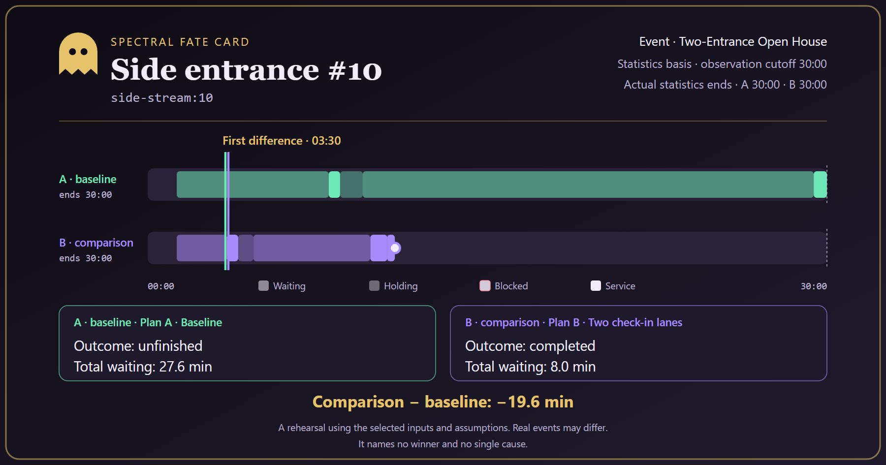

# Ghost Rehearsal 👻

**Rehearse an event before the real guests arrive.**

Ghost Rehearsal is a zero-backend, browser-based discrete-event simulation (DES) workbench dressed as a **Midnight Haunted Stage** for **Kiroween 2026 (Costume Contest)**. Build an event flow, rehearse two staffing arrangements with the exact same simulated guests, and follow an individual ghost across both futures to see—and hear—where their wait and outcome diverge.

[Open the live workbench](https://kanzaler123.github.io/ghost-rehearsal/) · [Built with Kiro](#built-with-kiro) · [Run locally](#run-locally) · [Project structure](#project-structure) · [MIT License](LICENSE)


| Midnight Opening | Spectral Fate Card (1200×630 SVG / 2× PNG) |
| --- | --- |
|  |  |

---

## Highlights

- **Midnight Opening & Guided Walkthrough:** First launch opens an interactive **Midnight Opening** stage previewing Side entrance guest #10's divergence across Plans A and B—no upfront worker spin-up required. Jump directly into the **60-second A/B/C guide**, a six-step spotlight **Feature tour**, or custom event setup.
- **Visual Flow Builder (`Build`):** Drag entrances, staffed services, probability/attribute decisions, batch-release waiting areas, merges, exits, and foldable subflow stages on a ComfyUI-inspired React Flow canvas with undo/redo, stage-aware auto-layout, reusable node/plan templates, and observed CSV/TSV arrival & service-sample import ([data entry guide](docs/data-entry.md)).
- **Deterministic Browser Rehearsal (`Rehearse`):** Runs inside a local Web Worker with keyed Common Random Numbers so the same guest ID experiences identical baseline draws across plans. Models shared multi-skill staff and devices (bipartite matching), shifts, handovers, planned unavailability, queue capacities, overflow routing, and opening/closing drain rules.
- **Two Futures, Spectral Soundscape & Fate Card Stage (`Compare`):**
  - Replay synchronized A/B haunted-stage canvases side by side on a shared queue gauge scale, with overload ghost flames, glowing route flows, traveller orbs, and a rotating spotlight on the tracked guest.
  - Toggle **Spectral sound** (optional, muted by default, zero external audio files, silent under `prefers-reduced-motion`) for procedural Web Audio synthesis: a tritone rift chord at first divergence (`03:30` for Side entrance #10), rate-limited ember pulses on newly crowded stations, and a completion bell.
  - Open the **Spectral fate card preview** modal directly on stage to inspect the tracked guest's bilingual `1200×630` comparison poster and download it as standalone **SVG** or **2× PNG (`2400×1260`)**.
- **A/B/C Decision Loop & Robustness Lab:** In the built-in Open House guide, Plan B splits check-in into two lanes (`43 → 41` completions at 30 min; kit pickup remains congested), while **Experiment C** adds one packing worker (`+0.5` staff-hours → `72` completions, average wait `17.6 → 15.9 min`, and `4` more early departures). Sweep plans across seeds and slower-service multipliers in **Robustness Lab** ([experiment contract](docs/robustness-contract.md)).
- **Local-First & Bilingual:** English and Chinese UI, browser draft branch-recovery, canonical JSON import/export with SHA-256 semantic staleness detection, readable comparison/operational exports ([comparison report guide](docs/comparison-report.md)), and **zero external runtime network requests** (fonts, icons, Canvas 2D atmosphere, Web Audio, and SVG/PNG export are all local).

---

## 60-Second Guided Demo

1. Open [the live workbench](https://kanzaler123.github.io/ghost-rehearsal/) and click **Try the 60-second A/B guide** on the Midnight Opening page.
2. Inspect **Two Futures**: compare A vs. B completions (`43 → 41`), waiting groups (default threshold: at least 60 seconds; switchable to **Any change**), early departures, and resource costs.
3. Click **Follow the same guest → Jump to first difference** (`03:30` for **Side entrance #10**), optionally turn on **Spectral sound**, scrub to `08:00`, and open **Export fate card** to preview and download their SVG or 2× PNG poster.
4. Click **Inspect posts and resources → Inspect packing evidence → Create C and compare** to test adding one packing worker (`41 → 72` completions), inspect every outcome and trade-off, and export C's operational plan.

---

## Built with Kiro

We used all four Kiro pillars—**Specs**, **always-on Steering**, **Hooks**, and a **custom local MCP server**—to transform a deterministic DES engine into the **Midnight Haunted Stage** while keeping all **6 frozen SHA-256 simulation digests** byte-identical:

| Kiro Pillar | Workspace Artifacts | What It Delivered |
| --- | --- | --- |
| **Specs** (requirements-first) | [`.kiro/specs/haunted-stage-ui/`](.kiro/specs/haunted-stage-ui/) · [`.kiro/specs/haunted-stage-encore/`](.kiro/specs/haunted-stage-encore/) · [`.kiro/specs/ghost-rehearsal-mcp/`](.kiro/specs/ghost-rehearsal-mcp/) · [`.kiro/specs/fate-card-stage/`](.kiro/specs/fate-card-stage/) | Froze visual geometry, WCAG contrast, reduced-motion limits, pure-function APIs, and zero-simulation-mutation contracts before implementation across 4 major Costume Contest milestones (`55ce3c6`, `2c400bb`, `62167e4`, `c3bd8b1`). |
| **Always-On Steering** (`inclusion: always`) | [`.kiro/steering/haunted-stage.md`](.kiro/steering/haunted-stage.md) · [`.kiro/steering/comparison-evidence.md`](.kiro/steering/comparison-evidence.md) | Authored by Kiro (`72ffc63`) to carry UI, token-only CSS, contrast, zero-network, and statistical-integrity guardrails automatically across every subsequent session (Encore, opening-scene parallax fix `b8165f2`, MCP server, and Fate Card Stage). |
| **Automated Invariant Hook** (`PostFileSave`) | [`.kiro/hooks/guard-haunted-invariants.json`](.kiro/hooks/guard-haunted-invariants.json) · [`scripts/guard-haunted-invariants.mjs`](scripts/guard-haunted-invariants.mjs) | Zero-credit local command Hook watching `src/components/**` and `src/app/styles/**`, running the 12 frozen SHA-256 digest and CSS/WCAG contract tests automatically on save (hardened with a 150ms non-blocking stdin reader and 5 unit tests in [`tests/guard-haunted-invariants.test.ts`](tests/guard-haunted-invariants.test.ts)). |
| **Custom Local Engine MCP Server** (zero new deps) | [`.kiro/settings/mcp.json`](.kiro/settings/mcp.json) · [`scripts/ghost-rehearsal-mcp.mjs`](scripts/ghost-rehearsal-mcp.mjs) · [`scripts/mcp/`](scripts/mcp/) | Dev-time JSON-RPC 2.0 stdio MCP server (`ghost-rehearsal-engine`), compiled on demand via the installed `rolldown` bundler with zero bytes in `dist/` and verified by 44 tests in [`tests/mcp-server.test.ts`](tests/mcp-server.test.ts). Exposes 4 read-only tools directly to Kiro: `verify_simulation_invariants`, `inspect_guest_divergence`, `validate_event_project`, and `render_fate_card_svg`. Kiro invoked these tools live during `fate-card-stage` to verify 6/6 frozen SHA-256 digests and `side-stream:10` diverging at `03:30`. |

---

## Run Locally

Requires **Node.js 24 LTS** (or any version matching `engines.node` in [`package.json`](package.json)) and npm. No environment variables, API keys, or backend services are required.

```sh
git clone https://github.com/kanzaler123/ghost-rehearsal.git
cd ghost-rehearsal
npm ci
npm run dev
```

Open `http://127.0.0.1:5173` (or the URL printed by Vite).

### Build & Verification

```sh
npm run check                             # Dual strict TypeScript checks + 671 Vitest unit tests (45 files)
node --test e2e/release/gate-checks.mjs   # 37 release-gate policy tests
npm run build -- --base=/ghost-rehearsal/ # Zero-warning Vite 8 production build
npm run preview                           # Serve dist/ locally
```

To run the real-Chromium / production-Worker browser smoke suite (48 checks across desktop & 390px mobile in English and Chinese):

```sh
npx playwright install chromium
npm run test:browser:smoke
```

For the full Chromium suite matching CI shards: `npm run test:browser -- --shard=1/2` and `npm run test:browser -- --shard=2/2`.

Pushes to `main` run the 14-job cross-browser [GitHub Actions workflow](.github/workflows/pages.yml) (typecheck, unit tests, release gates, Chromium, Chromium Touch, Firefox, WebKit shards, and dedicated WebKit import/comparison suites) before deploying to GitHub Pages.

---

## Scope & Limitations

- **Synthetic examples, not field calibration:** Built-in scenarios use synthetic parameters; no real-event organizer trial is claimed. Use the [field-validation worksheet](docs/field-validation.md) and CSV/TSV importers to calibrate against measured data. This is an operational process model, not a crowd-safety or evacuation certification tool.
- **Transparent trade-offs & protective caps:** The 10,000-guest cap is a protective limit rather than a performance certification. Paired waiting groups exclude guests who departed early on either side (while keeping all 300 in outcome counts) and report a separate **Completed only** summary. Backlog evidence highlights simultaneous constraints rather than proving a single cause.
- **Browser-local persistence:** Project drafts and templates stay in your browser; export JSON files for backup or cross-device sharing. Schema codec currently supports version 1.

---

## Project Structure

| Path | Contents |
| --- | --- |
| [`.kiro/`](.kiro/) | Kiro Specs (`specs/`), always-on Steering (`steering/`), `PostFileSave` invariant Hook (`hooks/`), and local MCP config (`settings/mcp.json`) |
| [`src/app/`](src/app/), [`src/components/`](src/components/) | React 19 workbench, Midnight Opening, flow canvas, inspector, `SpectralStageBackdrop`, `FateCardModal`, and comparison views |
| [`src/features/`](src/features/) | Project operations, templates, comparison analysis, Spectral Soundscape (`soundscape.ts`), and Fate Card SVG / 2× PNG export (`fateCard.ts`) |
| [`src/simulation/`](src/simulation/), [`src/schemas/`](src/schemas/) | Deterministic Web Worker DES engine, Zod schemas, graph validator, and synchronous SHA-256 semantic fingerprinting |
| [`src/experiments/robustness/`](src/experiments/robustness/) | The workbench’s Robustness Lab panel and the worker that runs batches of simulations |
| [`src/i18n/`](src/i18n/) | English and Chinese UI copy |
| [`scripts/`](scripts/) | Local dev-time MCP server (`mcp/`, `ghost-rehearsal-mcp.mjs`), Hook guard (`guard-haunted-invariants.mjs`), and React Flow patch |
| [`tests/`](tests/), [`e2e/`](e2e/) | 671 Vitest unit tests (including 6 frozen SHA-256 digests), 37 release-gate tests, and cross-browser Playwright suites |
| [`examples/`](examples/) | Synthetic two-plan Open House project ([`open-house.json`](examples/open-house.json)) |
| [`labs/`](labs/) | Standalone development pages for trying the data editors and Robustness Lab with the Open House example |
| [`docs/`](docs/) | README screenshots (`images/`) and user guides ([`data-entry.md`](docs/data-entry.md), [`comparison-report.md`](docs/comparison-report.md), [`robustness-contract.md`](docs/robustness-contract.md), [`field-validation.md`](docs/field-validation.md)) |

---

## License

Original project code is released under the [MIT License](LICENSE). Bundled dependencies and local fonts retain their respective licenses; notices are included in [`public/THIRD_PARTY_NOTICES.txt`](public/THIRD_PARTY_NOTICES.txt).
