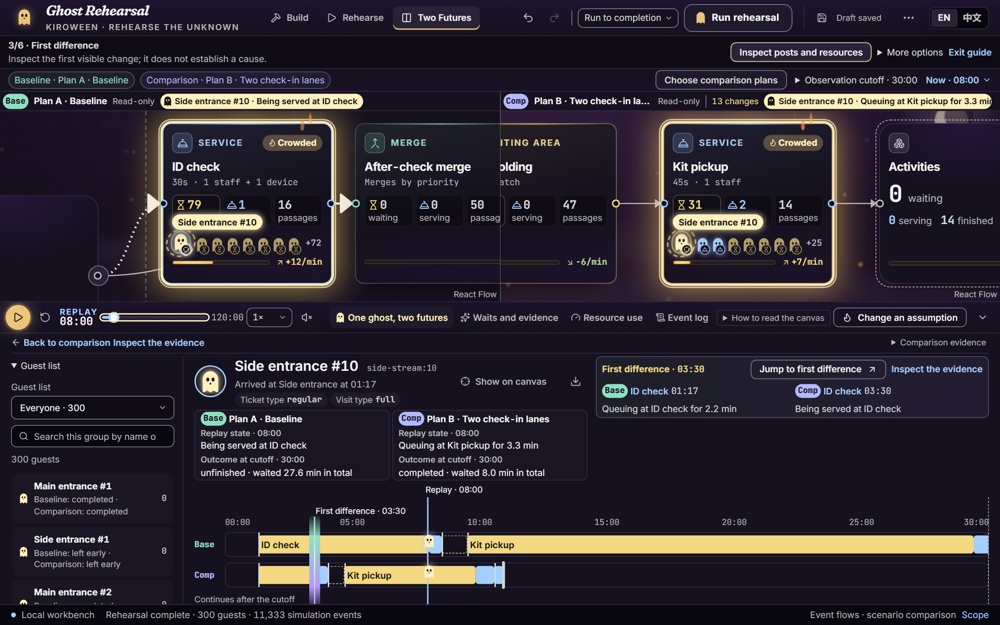
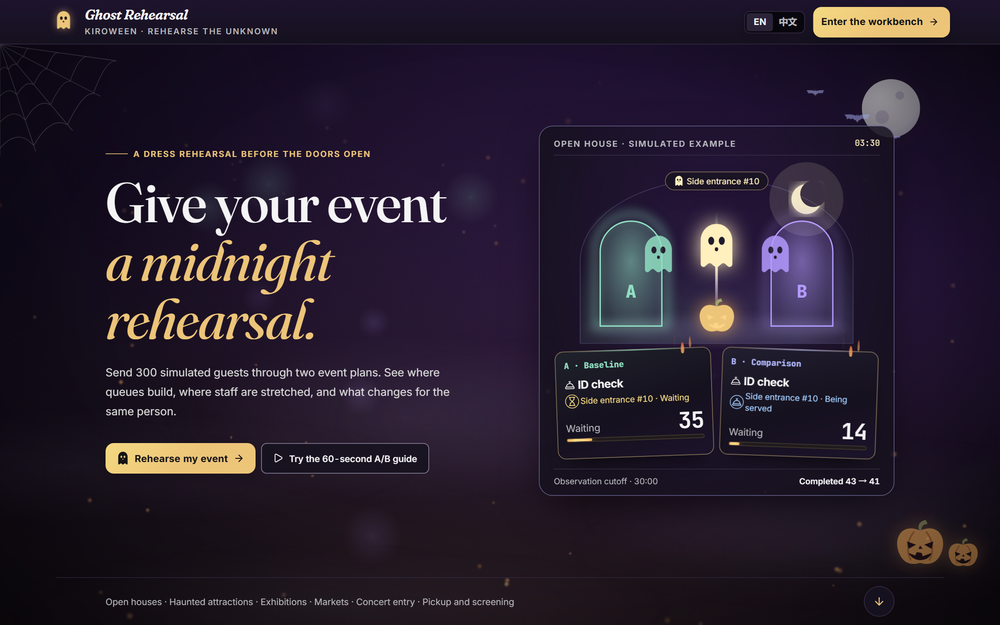

# Ghost Rehearsal 👻

**Rehearse an event before the real guests arrive.**

See how staffing and flow decisions change people’s waiting before real guests arrive. Build an event, rehearse two arrangements with the same simulated guests, then follow the same person across both plans to see where their wait and outcome changed. The ghosts make those individual journeys visible.

[Open the live workbench](https://kanzaler123.github.io/ghost-rehearsal/) · [Kiro usage status](KIRO_USAGE.md) · [Submission kit](docs/kiroween-submission.md) · [MIT license](LICENSE)



| Midnight Opening | Exported Spectral Fate Card (1200×630 SVG) |
| --- | --- |
|  |  |

## What you can do

- **Open on a Midnight Stage:** first launch opens an interactive **Midnight Opening** landing page with a live timeline preview of Side entrance guest #10 (no simulation worker needed upfront). Jump straight into **Try the 60-second A/B guide**, or click **Rehearse my event** / **Enter the workbench** to choose between a six-step **Feature tour**, the **A/B guide**, or **Set up my event**. Return to the opening anytime from the top-left logo, or revisit the tour from **More options**.
- **Start with an event:** set its name, guest count, duration, and arrival window. Each event has its own plans; creating another event keeps the existing ones.
- **Build a flow:** entrances, services, decisions, waiting areas, merges, exits, and subflow groups; curved connections, parameter editing, undo/redo, and stage-aware automatic layout. Subflows are drawn as stage frames, and the default view stays zoomed in far enough to read service times. Double-click the canvas to find a node, use right-click menus, or switch between selection and hand tools.
- **Reuse your work:** start with Haunted House, Trick or Treat, Open House, or a blank plan. Save a node or an entire plan as a template. Each plan has its own node list. When applying a node template, choose shared or copied resources; matching shared posts include the new node, while copies add staff and equipment.
- **Run a rehearsal:** deterministic arrivals and sampling, queues, branching, batch release, shared staff and equipment, shifts, handovers, and opening/closing rules.
- **Follow the ghosts:** replay actual simulation events in a stage view that folds each top-level subflow into one card. Click a stage to open it. Cards show waiting, service, blocking and one-minute queue trends in one shared colour scheme. Queue bars use the same scale across both plans. On phones, drag the rehearsal timeline to a time or tap an event marker beneath it. Choose a guest from stories such as “waited longest” or “queuing now” to pin their label on the canvas and inspect their aligned timelines and recorded events. Route markers represent recorded transfers. Zero-time transfers have no travel animation. Toggle **Spectral sound** in the replay timeline (muted by default; pure Web Audio API with zero external audio files) to hear a soft two-tone rift chord at first divergence, ember pulses on queue overload, and a completion bell.
- **Compare Two Futures:** start in **Overview**, with two synchronized canvases and a summary of completions, average waiting, and resource cost. Expand the report sections to inspect concrete input changes, outcomes, affected guests, where waiting changed, and resource use. Both canvases can open and zoom to the same stage. Try a slower-service stress scenario; changed inputs mark previous results as stale.
- **Inspect the people behind the numbers:** click an affected-group count or **Guest journey**. On desktop, both canvases stay above the guest’s timelines and follow their station in each plan as you play or drag the timeline. On phones, switch between **Guest journey** and **Flow**. Browse the complete guest list with search and pagination, filtering by less waiting, more waiting, little change, or finishing in only one plan. Representative stories combine multiple labels for the same person. Compare the guest’s aligned lanes, outcome, first visible difference, station totals and recorded events, open the **Spectral fate card preview** modal to inspect their bilingual 1200×630 poster and download it as **SVG** or **2× PNG (2400×1260)**, then return to **Overview**. These details use the observation cutoff by default, or the final/run-limit record after a full run.
- **Keep your plans:** recover browser drafts, save locally, import/export project JSON, and export staff posts, batch rules, routes, closures and parameter sources as a readable operational plan. Switch between English and Chinese.
- **Use observed inputs:** import arrival CSV/TSV in an arrival group's **Event settings**, or service samples in a service node's Inspector. Choose units, preview errors and converted values, and explicitly apply the import. Arrival imports require the outer shared-event Apply; a service import is one undoable edit. Source notes survive manual value changes, which reset the source label to User estimate. See [data entry](docs/data-entry.md).
- **Test robustness:** open **Robustness lab** from Two Futures to run the selected plans across seeds and service multipliers at the displayed observation cutoff. The batch uses a fixed input snapshot; changed settings mark its results as out of date. Cancel or close the panel to stop its worker. Export a single group to reopen and reproduce it in the workbench. See [the experiment contract](docs/robustness-contract.md).

No account, API key, or backend is needed. Simulation runs in a browser worker; project data stays in your browser unless you export it. Fonts and icons are bundled locally.

## Quick start

1. Open the workbench and click **Try the 60-second A/B guide** on the Midnight Opening page—or click **Enter the workbench** and choose **Follow a guest through A/B** (you can also pick **Explore the workbench** for a six-step spotlight tour, or start **Start the A/B/C guide** from the Build sidebar). The guide adds its own example plans and preserves existing events. [Open the live workbench](https://kanzaler123.github.io/ghost-rehearsal/) · [Run locally](#run-locally)
2. Read the A/B results: completed, unfinished, early departures, average/P90 waiting and resource costs. The example is synthetic, and B changes several arrangements at once.
3. Choose **Follow the same guest**, then **Jump to first difference**. At 03:30, Side entrance #10 is queuing at ID check in A and being served there in B. Drag the timeline to 08:00 to see A still at ID check while B is already queuing at Kit pickup.
4. Choose **Inspect posts and resources**, then **Inspect packing evidence**. Check staff eligibility, actual postings and availability; the backlog alone does not establish a unique cause.
5. Choose **Create C and compare**. C adds one packing worker with the original worker's shifts and unavailable periods. Read all B/C outcomes and **View resource costs**; extra completions can accompany extra departures.
6. Choose **Prepare C export**, then **Download C arrangement**. The file includes C's rules, posts, sources and B/C evidence using the selected statistics basis and waiting rule.

### Save and reopen the guide

**Download A/B/C experiment** saves a separate, importable JSON containing only the guide's three plans and shared inputs; it leaves other events in the workbench. Re-import the JSON, open **Two Futures**, and choose **Choose comparison plans**. Select original B on the left and the packing-support experiment C on the right, select **Run to completion**, then run the comparison. This reruns both plans; cancelling the picker preserves the current comparison and guide step.

Computed results, guide progress and view settings are not stored in the project file. **Reset guide** reuses its plans, **Rerun this comparison** recalculates them, and **Exit guide** leaves them available for free editing in Build.

The original two-plan example, blank flows, Haunted house and reusable templates remain available. Selecting Build exits the guide; normal project export preserves all its plans, while simulation results are recalculated after import.

## Reading comparison results

Choose **Run to completion** in the top toolbar next to **Run rehearsal**, rerun, and select **Statistics basis → Final / run limit** to inspect final summaries, guest waits and resource use. A final run can still contain unfinished guests if it reaches the limit. Statistics are separate from the current replay time. Accepting successful cutoff results selects the observation-cutoff statistics automatically; a full run keeps your selected statistics basis. Changing only the next run's settings does not change the selected basis. While computing, you can still inspect the previous results; cancelling keeps those results and your current statistics basis.

The comparison's **Waiting change rule** defaults to **At least 60 seconds** (inclusive). Choose **Any change** to include every nonzero change at millisecond resolution. Overview, Insights, guest filters, stories, histogram and comparison-evidence export share this setting. The left slot is the baseline and the right slot is the comparison. Waiting groups and their histogram exclude guests who left early on either side. At the Open House cutoff, 9 guests waited at least a minute less, 9 waited at least a minute more and 276 changed by less than a minute. The other 6 paired guests left early. All 300 still count toward outcome comparisons.

Primary waiting includes all arrived guests; the separate **Completed only** group shows its own sample size, mean and P90 (90th percentile). Each side reports its actual statistics end, arrived/not-arrived counts and exclusions from the paired sample. Final results may end at different times. Missing final results and stale comparisons do not supply current comparison evidence.

## Editing and saving plans

**Event settings** supports arrival-group additions/removals, arrival patterns and time slots. The Inspector edits routing conditions and service samples; **Staff & devices** edits multiple shifts. Event, opening and shift times are displayed in minutes from the start; short service and handover durations remain in seconds. Plans can be renamed or deleted (with Undo available).

### Draft recovery

Applied project edits are saved as drafts separately from manual saves when their data format is valid. Autosave keeps the latest 20 revisions along each branch, plus manual saves, fork and merge points, and their recovery choices. Apply changes in dialogs before relying on draft recovery. Refresh restores the newest draft; incomplete/invalid edits and unavailable storage trigger leave protection. A browser draft is local to that browser, so export important projects as files. Rehearsal results are recalculated after reloading.

### Templates and backups

Templates are stored separately from the current project in the same browser. In **Templates**, choose **Export all** to pack every saved node and plan into one JSON file. On another device, choose **Import templates** and select that backup, multiple individual files, or a mix of both. Each saved template also retains its own download button.

Imports add independent copies without replacing existing templates or the current project. If any selected file is invalid or unsupported, the whole batch is rejected and the library stays unchanged.

Plan template files include the flow, arrivals, and resources. Node template files retain the source plan and scenario as context for resource reuse; applying one adds the selected node and its resource dependencies. Project JSON exports do not include the saved-template library, so export the templates you want to keep separately. Simulation results are recalculated after a reload.

### Project imports

Project files use a canonical JSON format with explicit defaults and unordered collections sorted by ID. Reopening or importing selects the first plan in that order. Invalid imports list every detected issue and preserve the current project, including unsaved edits; files from a newer schema version require an updated application.

### Canvas controls

The event selector and **Event settings** button sit above the plan list. Only plans belonging to the selected event are shown. The canvas takes interaction cues from [ComfyUI's canvas controls](https://docs.comfy.org/interface/canvas-controls): drag a selection box in Select mode, hold Space or the middle mouse button to pan, scroll to zoom, or use the Hand tool. Shift/Ctrl/Cmd-click selects multiple nodes. Double-click or right-click empty canvas to add a node at that location; right-click a node to edit or delete it. Canvas insertion and opening the inspector preserve the viewport.

## Run locally

Use **Node.js 24 LTS** and npm. The supported Node versions are declared in `package.json`.

```sh
git clone https://github.com/kanzaler123/ghost-rehearsal.git
cd ghost-rehearsal
npm ci
npm run dev
```

Open `http://127.0.0.1:5173` or the address printed by Vite.

```sh
npm run check
npm run build
npm run preview
```

`check` runs both strict TypeScript checks and the automated tests once. `build` produces `dist/`; `preview` serves that build locally. There are no environment variables or external services to configure.

For the fast real-Chromium / production-Worker smoke suite (40 tests covering the production subpath build, Midnight Opening, six-step tour, and critical save/run/compare/export flows across desktop/390px in English and Chinese), run `npx playwright install chromium` and then:

```sh
npm run test:browser:smoke
```

To run the full Chromium suite locally without hitting the 10-minute global timeout in `playwright.config.ts`, run both shards matching CI: `npm run test:browser -- --shard=1/2` and `npm run test:browser -- --shard=2/2`. Playwright builds the `/ghost-rehearsal/` subpath bundle and starts its own preview server on port 4178. Failure traces, screenshots, downloads and a JSON result go to ignored `test-results/`; the HTML report is in `playwright-report/`.

## Deployment and verification

[GitHub Actions](https://github.com/kanzaler123/ghost-rehearsal/actions/workflows/pages.yml) installs the locked dependencies, runs tests and type checks, and builds the site. Successful pushes to `main` deploy to GitHub Pages; pull requests run the checks without deployment.

The Pages build uses `/ghost-rehearsal/` as its base path. If you fork and publish under another repository name, update the build argument in [the workflow](.github/workflows/pages.yml), and select **GitHub Actions** in **Settings → Pages**. A normal local build uses `/`.

See [GitHub Actions](https://github.com/kanzaler123/ghost-rehearsal/actions/workflows/pages.yml) for checks and deployment status for each revision. The [2026-11-15 validation record](docs/validation-2026-11-15.md) documents an earlier checkpoint, including test counts, browser evidence, intermediate failures and remaining work. Those historical results do not establish the status of the latest commit.

- On 2026-11-18, the Haunted Stage fixes passed both TypeScript checks, all 592 unit tests, a production build and 80 targeted Chromium tests across English and Chinese desktop and mobile layouts. One Chinese mobile playback test timed out on the first pass. It then passed three isolated runs and the 80-test rerun. [Tested revision](https://github.com/kanzaler123/ghost-rehearsal/commit/9ec4f01115275c1ea60c02533263374ee43af857)
- On 2026-11-19, commit [`0d8d400`](https://github.com/kanzaler123/ghost-rehearsal/commit/0d8d400) added Vite 8 vendor chunk splitting (`index-*.js` reduced from 1,007 kB to 490 kB with zero chunk-size warnings) and `npm run test:browser:smoke`, passing both TypeScript checks, all 593 unit tests, all 37 release-gate checks (`node --test e2e/release/gate-checks.mjs`), the `/ghost-rehearsal/` subpath build, all 40 local Chromium smoke tests, and the full cross-browser GitHub Actions deployment pipeline ([run `44429878793`](https://github.com/kanzaler123/ghost-rehearsal/actions/runs/44429878793): Chromium, Chromium Touch, Firefox, WebKit shards, import/comparison WebKit, and Pages deploy).
- On 2026-11-19, Kiro implemented **Haunted Stage Encore** (Spectral Soundscape + Spectral Fate Card SVG export, commit `2c400bb`, governed by Kiro's new `.kiro/steering/haunted-stage.md` in `72ffc63`), followed by post-review edge-case polish and `app-i18n` chunk splitting (`c7385bd`, zero-warning build with `index-*.js` at 412 kB), verified locally across 616 unit tests, 37 release-gate checks, and real-Chromium Encore, first-screen, and smoke browser suites.
- On 2026-11-20, following Encore replay, layout, and navigation refinements (`343eaa7`, `06b78c8`, `fb038f3`) and Kiro's opening-scene mouse-parallax fix (`b8165f2`), `main` passed both TypeScript checks, all 618 unit tests, all 37 release-gate checks, the zero-warning `/ghost-rehearsal/` production build (`index-*.js` at 419 kB), and the full 14-job cross-browser GitHub Actions deployment pipeline ([run `44668793382`](https://github.com/kanzaler123/ghost-rehearsal/actions/runs/44668793382)).
- On 2026-11-20, Kiro hardened the local `PostFileSave` UI invariant Hook (`scripts/guard-haunted-invariants.mjs`, 5 tests), built the zero-dependency dev-time engine MCP server (`.kiro/specs/ghost-rehearsal-mcp/`, `.kiro/settings/mcp.json`, 44 tests, zero browser bundle leakage), and delivered the interactive **Spectral Fate Card Stage** preview modal with 2× PNG (`2400×1260`) & SVG dual export (`.kiro/specs/fate-card-stage/`, verified live with Kiro's own MCP tools, 671 unit tests across 45 files, 37 release-gate checks, zero-warning `422 kB` main bundle, 16/16 Encore & first-screen Playwright tests, and 48/48 smoke tests).

## Scope and limitations

This is a working preview. The planning specification describes a broader target; the preview has **not** completed acceptance of all 47 requirements.

- No real-event calibration or organizer trial has been completed or claimed. Use the [field-validation worksheet](docs/field-validation.md) to collect measured inputs and record whether a real organizer changes their arrangement.
- Example parameters are synthetic. Results describe the supplied assumptions, not guaranteed outcomes at a real event. This is an operational process model, not a crowd-safety or evacuation certification tool.
- The 10,000-guest run cap is a protective limit, not a performance certification at that size.
- Subflows group members for display and act as stages in Rehearse and Two Futures; they do not change the simulation. Advanced JSON editing is still needed for attribute definitions/distributions; per-guest arrival records can be imported through Event settings.
- Comparison summaries and guest-journey lanes, outcomes, event evidence and station totals default to the observation cutoff. After running to completion, select the final/run-limit basis to inspect the full results. The journey view, report and resource summaries follow the selected basis. Backlog evidence describes simultaneous constraints; it does not prove a unique cause.
- Stale-result detection uses canonical SHA-256 fingerprints. Display names and layout changes preserve results; simulation inputs and provenance kinds affect the fingerprint. Omitted transfer durations remain omitted, without invented provenance. The codec currently supports schema version 1; historical migrations will need implementation when the format advances.
- The complete output contracts, extended golden cases, large-scale benchmarks, and full keyboard-interaction acceptance remain unfinished.

## Kiroween 2026

Intended category: **Costume Contest**. Ghosts represent the same simulated guests across alternative arrangements, making queues, individual waiting, replay soundscape cues, and previewable/exportable SVG & 2× PNG fate cards visible on a Midnight Haunted Stage.

The public repository includes the source, examples, setup instructions, an open-source license, the root [`.kiro/`](.kiro/) directory (12 specs, 2 always-on steering files, 2 hook configurations, and 1 local dev-time engine MCP server), and an English [submission kit & demo script](docs/kiroween-submission.md). English product, Kiro usage, and testing instructions are included; internal planning specs and historical verification records retain their original Chinese entries.

**Submission status:** Source, tests, `.kiro/` artifacts, refreshed screenshots, English Kiro usage guide ([KIRO_USAGE.md](KIRO_USAGE.md)), and the Devpost / demo video script ([docs/kiroween-submission.md](docs/kiroween-submission.md)) are synced and ready for final deployment and submission. Kiro drove the Costume Contest transformation using all four pillars—**Specs, always-on Steering, Hooks, and a custom local MCP server**—delivering the Midnight Haunted Stage (`55ce3c6`), `.kiro/steering/haunted-stage.md` (`72ffc63`), Haunted Stage Encore (`2c400bb`), opening-scene polish (`b8165f2`), hardened `PostFileSave` invariant Hook, the zero-dependency `ghost-rehearsal-engine` MCP server, and the **Spectral Fate Card Stage** preview modal with 2× PNG/SVG export (verified live with Kiro's own MCP tools), with the Stop Hook automatically recording six post-session engineering logs. Recording/uploading the <3-minute public YouTube demo and submitting the Devpost form remain the final steps. See the [official competition requirements](https://kiroween.devpost.com/rules).

## Project map

| Location | Contents |
| --- | --- |
| `src/app/`, `src/components/` | React workbench, Midnight Opening, flow canvas, inspector, Fate Card preview modal, and results |
| `src/features/` | Project operations, examples, templates, analysis, Spectral Soundscape, and Fate Card SVG / 2× PNG export |
| `src/simulation/` | Simulation worker, deterministic event engine, and metrics |
| `src/schemas/` | Input schemas, graph validation, SHA-256 fingerprints, and plan operations |
| `src/i18n/` | English and Chinese interface text |
| `scripts/mcp/` | Zero-dependency local dev-time MCP server exposing the real DES engine & validator to Kiro |
| `tests/`, `e2e/` | 671 unit tests (45 files), 37 release-gate tests, and cross-browser Playwright E2E suites |
| [examples/open-house.json](examples/open-house.json) | Synthetic two-plan Open House example |
| [.kiro/specs/](.kiro/specs/) | Requirements, design, and task specs (including `haunted-stage-ui`, `haunted-stage-encore`, `ghost-rehearsal-mcp`, `fate-card-stage`, and `product-foundation`) |
| [.kiro/hooks/](.kiro/hooks/) | Kiro Stop Hook (6 end-to-end auto-logged entries) and local `PostFileSave` UI invariant guard |
| [.kiro/steering/](.kiro/steering/) | Always-on Haunted Stage UI guardrails (`haunted-stage.md`) and comparison evidence rules |
| [.kiro/settings/mcp.json](.kiro/settings/mcp.json) | Workspace registration for the local `ghost-rehearsal-engine` MCP server |
| [docs/kiroween-submission.md](docs/kiroween-submission.md) | English Devpost project story, 2:45 YouTube demo script, and submission checklist |
| [PLAN.md](PLAN.md) | Original product roadmap; planned scope, not a completion report |

Built with React, TypeScript, React Flow, Zod, Vite, and Vitest.

## License

Original project code is available under the [MIT license](LICENSE). Bundled dependencies and fonts retain their own licenses; their notices are included in [THIRD_PARTY_NOTICES.txt](public/THIRD_PARTY_NOTICES.txt) and distributed with the live build.
