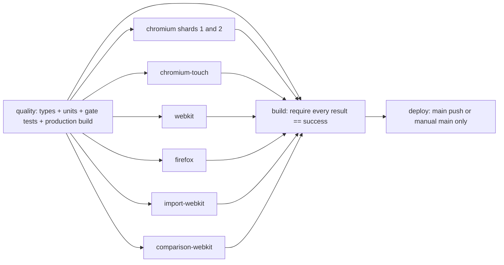

# E — 跨浏览器验证与发布保障

## 范围与基线

- 实际基线 / `origin/main`：`f8371999e64d25c250699e5cd96f85eabb79bb32`。2026-11-16 建立工作树前 fetch，并在提交前通过远端再次核对，和审查参考一致。
- 分支：`test/cross-browser-release-gates`；独立工作树：`C:\Users\kanzaler\Desktop\ghost-rehearsal-release-gates`。原 UI 工作树 `KIROWWEN` 的分支和未提交文件未改动。
- 仅修改测试配置、E 专属测试、工作流与本目录。未改 App、Canvas、组件、样式、业务模块、公共 Schema、依赖或锁文件。
- 实际工具贡献：Codex 编写、审查、执行本地验证并读取 GitHub 历史日志；没有使用 Kiro，不计为 Kiro 工作。
- **交付性质：发布阻塞机制和测试已实现；产品兼容性仍须通过全部检查。失败不通过跳过、重试、过滤错误或修改产品代码消除。真实 Safari 尚未验证。**

| 交付项 | 状态 |
| --- | --- |
| 显式浏览器/构建依赖、异常跳过与取消阻塞、诊断产物 | 本分支工作流已接入；main 尚未合并本分支，生产发布工作流尚未改变 |
| WebKit 核心、Firefox 冒烟、触摸契约 | 测试模块已完成并实际运行；最终改版 UI 的选择器适配和完整验收待统一集成 |
| 导出菜单、ResizeObserver、键盘焦点等产品问题 | 仍未解决，提供复现与候选位置，失败保持阻塞 |

## 历史失败核对

以下是指定草稿提交的证据，不代表当前 main 必现：

| 来源 | 已核实记录 | 结论边界 |
| --- | --- | --- |
| [PR #19](https://github.com/kanzaler123/ghost-rehearsal/pull/19)，head `9a52d300b62d0f8519706d0d1b70077e7e53b779` | [run 43764850278 / WebKit job 132967618662](https://github.com/kanzaler123/ghost-rehearsal/actions/runs/43764850278/job/132967618662)：25 通过、7 失败，均记录 `ResizeObserver loop completed with undelivered notifications.`。失败涉及桌面中英文比较、robustness 和 smoke；build 成功，deploy 跳过。 | 旧草稿基线 `ab12baea7215b7c919ad465370dcaed991217d81`；不能据此认定 f837 的同一流程必现。小 Canvas 实验不等于完整页面复现或修复。 |
| [PR #32](https://github.com/kanzaler123/ghost-rehearsal/pull/32)，head `6eb2f8279176dca7ad6dc3bba8b2b8e4c19d1334` | [run 43806387318 / focus-control 133098039979](https://github.com/kanzaler123/ghost-rehearsal/actions/runs/43806387318/job/133098039979)：main/candidate/candidate/main 各 3 次，main 6/6 通过、candidate 4/6 通过；两次失败为 Enter 打开添加节点后搜索框消失、焦点到 BODY。 | 此受控实验支持候选分支焦点回归；不支持宣称 main 的相同键盘行为必现失败。最终 UI 合并后须重新验收。 |
| PR #32 完整浏览器诊断 | 同一 run：Chromium 292 通过、4 个可选截图跳过；WebKit 291 通过、4 个可选截图跳过、1 失败。[WebKit shard 2 job 133098040166](https://github.com/kanzaler123/ghost-rehearsal/actions/runs/43806387318/job/133098040166)：移动中文 `ui/run-states.spec.ts` Worker 加载失败流程出现 ResizeObserver。 | WebKit 子集通过并不表示全套通过。 |
| PR #32 既有子集 | [run 43806215558](https://github.com/kanzaler123/ghost-rehearsal/actions/runs/43806215558)：`import-webkit`、`comparison-webkit` 成功。 | 这些子集未覆盖所有上述失败路径；本任务保留它们，并纳入部署依赖。 |

## 浏览器覆盖和行为契约

基线根配置有 284 个 Chromium 用例实例（27 个文件；280 个必跑、4 个原有可选截图）。现有 spec 文件与断言完全保留；根配置会自动包含 E 新增的 4 个用例，因此现在是 300 个实例（296 必跑 + 4 可选截图）。

| 稳定 job 名称 | 配置与范围 | 触摸 / 设备含义 |
| --- | --- | --- |
| `chromium (1)`、`chromium (2)` | 根配置完整套件，两份文件级 shard；桌面 1440×1000、窄屏 390×844，中英文各一套；共 300 实例 | 根 `mobile-*` 默认只是窄视口。原有 `ui/mobile-navigation.spec.ts`、`ui/timeline-touch.spec.ts` 自行启用 `hasTouch: true` 并使用 `tap()`；`touch-targets` 只测尺寸，不作为触摸证据。 |
| `webkit` | `e2e/release/playwright.config.ts` 的 4 个 WebKit 项目，64 实例；新关键流程，以及原有 demo/comparison、robustness/integration、data-sources/integration、accessibility、run-states、mobile-navigation、timeline-touch | 移动 WebKit 中英文项目显式 `hasTouch: true`。新用例操作用 `tap()`，并断言收到可信 `touchstart`；不以窄视口或 `maxTouchPoints` 替代触摸证据。 |
| `firefox` | E 配置桌面中英文关键流程，共 8 实例 | Firefox 桌面冒烟，不声称覆盖移动 Firefox。 |
| `chromium-touch` | E 配置移动中英文：新关键流程与原有两项真实触摸操作测试，共 12 实例 | `hasTouch: true`，新流程原生 `tap()` + 可信事件断言；保留窄屏旧套件。 |
| `import-webkit` | 原 `e2e/project/playwright.config.ts`：smoke、project/import、route-keyboard；48 实例 × 原有 repeat-each=3 = 144 | 保留原重复次数；这是原有稳定性检查，并非失败重试。 |
| `comparison-webkit` | 原 `e2e/comparison/playwright.config.ts`：run-statistics-basis、guide-mapping；24 实例 | 保留原 4 个桌面/窄屏项目。 |

所有配置继承 `retries: 0`，原超时及并行 worker 数未提高。CI 禁止 `.only`。`required-checks.ts` 要求每个必跑用例恰好一次成功；未执行、预期失败、意外 skip、失败后重试变绿及中断均失败。唯一例外是原 `ui/capture.spec.ts` 中未设置 `CAPTURE` 的指定可选截图用例；只有截图而没有必跑测试也失败。此例外没有扩展到任何产品验收用例。

### 新关键流程（`e2e/release/critical.spec.ts`）

| 契约 | 实际断言 | 集成后定位适配要求 |
| --- | --- | --- |
| 新建、参数编辑、手动保存、重开 | 新建 12 人、45 分钟观察窗、8 分钟到达；导出字段为 2700/480 秒；编辑为 60 分钟、保存；重载后导出字节相同，方案未意外改变 | 欢迎/参数窗口必须具备命名 dialog、关联 label；保存使用当前 title；活动入口暂用 `.event-picker summary`，UI 改版可提供等价语义入口。 |
| 打开、运行、暂停/跳转、A/B、导出重开 | 通过文件选择器读真实 example；生产路径 Worker；暂停后 210 秒保持不动，再跳 60 秒；显式选择 `baseline` 为 A、`alternative` 为 B、cutoff；断言 12/9/279；下载 JSON、重导入、再次比较和内容一致 | 模式使用 tab/aria-selected，回放使用命名 slider/按钮；比较选择器使用现有 labels。统计数字暂用 `.people-stats b`，最终可改为明确的统计 region/testid，但数值与方向断言不变。导入会规范化方案排序，不能假定演示入口与文件入口默认 A/B 顺序一致。 |
| 键盘 | 原生 Enter 打开添加节点，搜索框获得焦点；Escape 关闭并还焦点；Enter 进入回放、Space 暂停、ArrowRight 推进 slider | 工具栏暂用 `.canvas-tools` 缩小按钮范围，菜单必须保留 dialog 和搜索 label。不得用 JS 触发 click 或先强制聚焦菜单内容绕过焦点缺陷。 |
| 失败重试 | 只在测试中阻断生产 Worker 资源；失败 region 有且仅有一个重试动作、没有结论；恢复请求后点击重试，真实 Worker 与可用时间轴出现 | 错误状态必须保留命名 region；无结论暂用 `.conclusion-groups`。这不是 Playwright 测试重试。所有 pageerror（包括 ResizeObserver）仍失败。 |
| 数据导入 | 原 `data-sources/integration.spec.ts` 纳入 WebKit：CSV/粘贴、校验、应用、持久化等既有断言原样执行 | 按既有标签/测试标识适配最终 UI；不能仅因控件可见就视作数据已应用。 |

新用例每次附加浏览器版本、平台、项目、触摸设置、全部 pageerror、console 和 requestfailed 记录。显式 Worker 失败可能产生预期网络/console 记录，但没有过滤或隐藏 pageerror；既有用例的错误断言也未改动。

## 发布依赖

原先 Pages 的 `build` 只等待 Chromium，独立 Project import 工作流不能阻止部署。本次把原 `import-webkit`、`comparison-webkit` 搬入 `Check and deploy`，删除重复独立工作流；保留 job 名和完整测试范围。



- `build` 保持原聚合检查名，`if: always()` 读取 7 个直接依赖；`gate.mjs` 对每个要求严格 `success`，缺失/失败/取消/skip 均报错，不使用“非 failure 即成功”。37 项门槛测试验证这些负例及 reporter。
- `deploy.needs` 再显式列出 `build` 和所有 7 类检查；需聚合成功、输出 `deploy=true`、main、push 或 workflow_dispatch，且未取消。PR 即使全绿也输出 `deploy=false`；PR 不上传 Pages 发布包。没有 `workflow_run` 绕行部署。
- 工作流并发仍会取消旧同 ref run。被取消 run 不放行。测试内部 skip 由 reporter 拦截，job skip 由聚合拦截。
- 浏览器 job 全部在 `quality` 成功后运行；Chromium 两个 shard 使用 `fail-fast: false` 收齐失败证据。没有 continue-on-error。
- 所有 run steps 使用 bash 的失败/pipefail 语义，`tee` 不掩盖命令失败。日志放 `ci-logs/`，避免 Playwright 清空输出目录时丢失安装/启动日志。失败或完成时上传日志、HTML、JSON、截图和 trace，保留 14 天；上传缺少所有文件视为错误。
- 稳定检查名：`quality`、`chromium (1)`、`chromium (2)`、`chromium-touch`、`webkit`、`firefox`、`import-webkit`、`comparison-webkit`、`build`、`deploy`。原独立工作流名称消失；集成者须核对仓库 ruleset 是否使用旧工作流绑定，不能仅凭文件变更声称远端保护规则已配置。

## 实际执行命令与结果

环境：Windows、Node 24.18.0，现有依赖离线安装成功。最终 runtime-evidence 报告 Chromium 159.0.8154.6、Firefox 159.0、WebKit 27.2，platform 均为 win32。浏览器二进制为本机 Playwright 安装；Linux 结果必须单独记录，不能把 Windows 结果冒充 Linux。

```powershell
npm ci --offline
npm run check
node --test e2e/release/gate-checks.mjs
npm run build -- --base=/ghost-rehearsal/
$env:PLAYWRIGHT_PORT = '4186'
npx playwright test --config e2e/release/playwright.config.ts e2e/release/critical.spec.ts --project=desktop-firefox-en --project=desktop-webkit-en --project=mobile-webkit-zh --project=mobile-touch-en
```

已执行的开发验证：类型检查通过；既有 32 文件、463 项单元测试通过；门槛测试 37/37 通过；Playwright 启动时生产构建通过（既有大 chunk 提示仍存在）。新测试早期 JSON 读取、重复播放按钮定位、触摸能力判断和默认 A/B 顺序假设已修正；那些早期失败不算产品缺陷，也不作为最终通过证据。最终本地/CI 结果见下方更新。

CI 的完整命令（生产子路径 `/ghost-rehearsal/`）：

```sh
npm run test:browser -- --shard=1/2
npm run test:browser -- --shard=2/2
npx playwright test --config e2e/release/playwright.config.ts --project='*webkit*'
npx playwright test --config e2e/release/playwright.config.ts --project='*firefox*'
npx playwright test --config e2e/release/playwright.config.ts --project='mobile-touch-*'
npx playwright test --config e2e/project/playwright.config.ts --repeat-each=3
npx playwright test --config e2e/comparison/playwright.config.ts
```

只列清单时用 `--list --reporter=list`，避免将不执行测试的 inventory 命令误作门槛验证。失败复现可在命令末尾用具体 spec/project/grep 定位，但局部重跑通过不能替代完整套件结果。

### main 产品上的本地发现（未修改产品）

1. **Windows WebKit 导出菜单未打开 dialog**：新建活动或欢迎页导入 example → 原生点击/触摸“更多” → “导出” → 等待 dialog，10 秒后仍无 dialog。桌面英文与触摸中文均出现，Firefox 创建/保存流程可通过。相关位置 `src/components/shell/ContextMenu.tsx:8`（blur 时关闭 details）、`:10`（点击后关闭并还焦点）；`src/app/App.tsx:631` 的入口和 `:852` 的 dialog。建议集成者结合 trace 核实 pointer/focus/blur/click 时序，避免在内部激活尚未完成时关闭菜单；这里只是待验证原因，未修改 UI、未强制 click 或用键盘替代失败路径。
2. **Windows 移动 WebKit 重试流程捕获 ResizeObserver pageerror**：选择示例 → 阻断 Worker 加载 → 出现失败 → 解除阻断并重试；业务按钮/时间轴流程完成，但 trace 有 `ResizeObserver loop completed with undelivered notifications.`，错误断言保持失败。这说明 f837 的这个环境/路径可复现该错误，不意味着 PR #19 的 7 个路径都已复现。相关候选区域是 Canvas/ReactFlow 容器尺寸、失败状态和回放布局切换；需定位真正 observer 回路后修复，不能忽略 window error。
3. **Windows Firefox 添加节点键盘焦点不稳定**：最终测试在欢迎页选择示例 → focus 添加节点按钮 → 原生 Enter → 搜索框未获得焦点，dialog 已消失；等待 10 秒仍找不到。开发轮曾通过，最终 28d4bea 轮失败，不能用前一轮的通过解除阻塞。这是 f837 产品代码的本机 Firefox 新证据，不能与 PR #32 Linux candidate 的失败频率混用。候选相关位置 `src/components/Canvas.tsx:417` 的 `onMoveStart` 无条件 `setMenu(null)`，以及 `:341–348` 自动视口定位；建议记录自动移动的空 event 与用户移动，检查是否只有用户发起的移动才应关闭菜单，并验证卸载后的焦点去向。根因尚未确认，未修改 Canvas。

供集成者定位的单例命令（不替代完整门槛）：

```sh
npx playwright test --config e2e/release/playwright.config.ts --project=desktop-webkit-en --grep='create an event'
npx playwright test --config e2e/release/playwright.config.ts --project=mobile-webkit-zh --grep='Worker loading failure'
npx playwright test --config e2e/release/playwright.config.ts --project=desktop-firefox-en --grep='native keyboard'
```

## 集成后的最终验收清单

- [ ] 用最终集成 SHA 跑 `quality`、全部 Chromium、触摸 Chromium、WebKit 核心、Firefox、两个原 WebKit 子集；逐项记录完整结果，保留失败与 trace。
- [ ] 适配改版后的语义定位/稳定标识，保留上述行为、数字、键盘焦点、真实 Worker、下载重开与所有错误断言；不删断言、不加 retry、不改为隐藏输入注入绕过可见入口。
- [ ] 修复导出菜单、ResizeObserver 或其他实际失败后，完整规定范围全绿；单例复跑通过不足以解除阻塞。
- [ ] 在 PR run 实查 deploy 被跳过；任何必跑 job 失败/取消/skip 时 build 失败或取消、deploy 不运行；成功主分支 run 才可能发布。本任务不触发正式部署来验证。
- [ ] 核对远端保护规则与稳定 check 名，防止搬迁工作流后旧检查仍等待或被误删除。
- [ ] **真实 Safari 未验证**：在 macOS Safari 和 iPhone/iPad Safari 实测文件选择/下载重开、菜单激活、输入焦点/软键盘、Enter/Escape（有外接键盘时）、触摸回放/比较、Worker 失败恢复和旋转/短屏布局。Linux Playwright WebKit 是自动化引擎覆盖，不是这些设备的验证证明。
- [ ] 新增任务 A 持久化模块与其他并行模块接入后，另跑真实多标签页、权限/配额和关闭页面行为；本任务测试不构成未接入模块的整页修复证据。

## 最终执行记录

代码提交：`28d4beacadd211a3a3ce1f312e7b3b99b6ce40ac`；[Draft PR #37](https://github.com/kanzaler123/ghost-rehearsal/pull/37)。

本机最终关键流程命令于 2026-11-16 11:15:00 UTC 开始，188.4 秒，**10 通过 / 6 失败 / 0 跳过 / 0 重试，退出码 1**：

| 项目 | 通过 / 失败 | 未通过流程 |
| --- | --- | --- |
| desktop-firefox-en | 3 / 1 | 添加节点键盘焦点 |
| desktop-webkit-en | 2 / 2 | 新建参数编辑保存重开、打开运行比较导出重开，均在首次导出 dialog 处阻断；后续步骤不能算已验证 |
| mobile-webkit-zh（触摸） | 1 / 3 | 上述两个导出流程；Worker 失败后重试流程捕获 ResizeObserver |
| mobile-touch-en（Chromium 触摸） | 4 / 0 | 无；仅这 4 项，不替代完整 Chromium 套件 |

本地证据保留于该独立工作树的 `test-results/release-results.json`、`test-results/release-report/index.html` 和 `test-results/release/*/trace.zip` / `error-context.md` / `test-failed-1.png`；未将大二进制提交到仓库。

Linux [run 43856209079](https://github.com/kanzaler123/ghost-rehearsal/actions/runs/43856209079)，同一代码提交，`pull_request` 事件，最终 **failure**：

| job / 日志 | 结果 |
| --- | --- |
| [quality](https://github.com/kanzaler123/ghost-rehearsal/actions/runs/43856209079/job/133260997253) | 成功：类型检查、463 单元、37 门槛、生产构建 |
| [chromium (1)](https://github.com/kanzaler123/ghost-rehearsal/actions/runs/43856209079/job/133261330787) | 148 通过、2 个原有可选截图跳过 |
| [chromium (2)](https://github.com/kanzaler123/ghost-rehearsal/actions/runs/43856209079/job/133261330707) | 148 通过、2 个原有可选截图跳过 |
| [chromium-touch](https://github.com/kanzaler123/ghost-rehearsal/actions/runs/43856209079/job/133261330590) | 12/12 通过 |
| [webkit](https://github.com/kanzaler123/ghost-rehearsal/actions/runs/43856209079/job/133261330539) | 64/64 通过，5.0 分钟 |
| [firefox](https://github.com/kanzaler123/ghost-rehearsal/actions/runs/43856209079/job/133261330759) | 6 通过、2 失败；中英文 `native keyboard opens the add-node menu and Escape returns focus` 均在搜索框焦点断言失败，dialog 不存在 |
| [import-webkit](https://github.com/kanzaler123/ghost-rehearsal/actions/runs/43856209079/job/133261330694) | 144/144 通过，保留 repeat-each=3，6.2 分钟 |
| [comparison-webkit](https://github.com/kanzaler123/ghost-rehearsal/actions/runs/43856209079/job/133261330614) | 24/24 通过 |
| [build 聚合门槛](https://github.com/kanzaler123/ghost-rehearsal/actions/runs/43856209079/job/133265217938) | 失败，实际错误 `Required job firefox: failure`，退出码 1 |
| [deploy](https://github.com/kanzaler123/ghost-rehearsal/actions/runs/43856209079/job/133265288943) | skipped，没有发布 |

8 份诊断 artifact 均实际上传、未过期，保留到 2026-11-30；失败 Firefox artifact 为 `firefox-43856209079-1`（ID `14219309870`，含日志、HTML/JSON、截图和 trace），可从上述 run 下载。其他 artifact 按稳定 job 名加 run/attempt/shard 命名。实际验证了失败会阻塞；取消/缺失/意外跳过由 37 项门槛测试及依赖条件覆盖，没有宣称进行过真实取消发布演练。

与历史证据的区别：PR #19 的比较、robustness、smoke 对应范围在本轮 Linux 覆盖中通过，未重现那一轮的 7 个失败，不能宣称旧草稿的错误永远消失。PR #32 的历史 focus-control 中 main 6/6 通过仍是该次实验事实；本次独立的新 Firefox 键盘测试在 f837 产品代码上中英文都失败，必须作为当前阻塞。Windows WebKit 的导出/ResizeObserver 在本轮 Linux 关键流程中未复现，仍保留 Windows 风险和真实 Safari 待验收项。

代码与门槛已完成可独立验证的交付；**Firefox 键盘核心流程仍未通过，整体验收与发布继续阻塞**。后续文档提交仅补证据，不改变上述已测试代码；文档提交可能自动触发新的 CI，不能把本记录冒充未完成的新 run 结果。没有合并、部署或修改/关闭 PR #19、#32。
