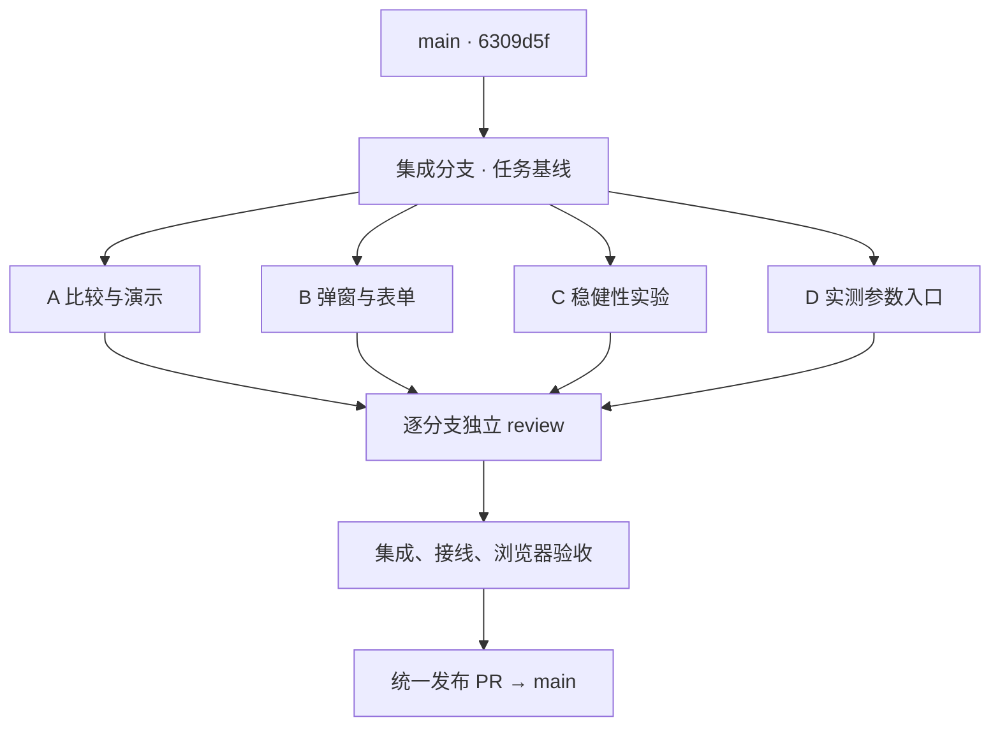

# Ghost Rehearsal：并行开发与统一发布任务包

状态：**待在 Kiro 中实施的任务计划**。本任务包由 Codex 于 2026-11-15 根据代码审查整理；它不是已经发生的 Kiro 开发记录，也不是功能完成报告。

共同产品基线：`6309d5f33ff3cb38a3e72d34e21b4d7a2ac5e6c2`。该基线已有 263 项测试和成功的生产构建、Pages 部署。后续各分支仍须报告自己的实际验证结果。

## 1. 执行方式

上一条交给 Kiro 的“比较口径＋A/B/C 引导演示”继续作为 **A**；已经启动的会话和分支可以继续使用，不要再创建一个重复实现相同功能的会话。

| 任务 | 工作分支 | 范围 | 启动时机 |
| --- | --- | --- | --- |
| [A：比较与演示](01-comparison-demo.md) | `kiro/comparison-demo` | 比较口径、引导演示、浏览器测试基础设施 | 继续上一条；先提交小型测试基础设施增量 |
| [B：弹窗与表单](02-dialog-form-reliability.md) | `kiro/dialog-form-reliability` | 弹窗层级、焦点、短屏滚动、数字编辑、资源 tabs | 立即并行 |
| [C：稳健性实验](03-robustness-lab.md) | `kiro/robustness-lab` | 多种子、多服务倍率、真实 Worker、结果矩阵与复现 | 立即并行；先在独立开发入口评审 |
| [D：实测参数入口](04-measured-inputs.md) | `kiro/measured-inputs` | 到达 CSV、服务样本、预览、来源与单位 | 立即并行；先在独立开发入口评审 |
| [E：统一集成与验收](05-integration-review.md) | 完成 A–D review 后，从集成分支创建 `kiro/release-verification` | 主界面接线、跨模块验收、材料定稿 | A–D 通过独立 review 后 |

所有开发 PR 的目标为 **`kiro/release-integration`**。只有 E 的最终验收通过后，才创建并合并从该集成分支到 `main` 的统一发布 PR。任务分支不得自行合入 `main`。



## 2. 每个会话用独立 worktree

一个 checkout 不能被四个会话轮流切换分支后并行编辑。使用独立目录，并让每个 Kiro 窗口打开自己的目录。

以下示例适用于远端工作分支已创建、同名本地分支尚不存在的情况：

```sh
git fetch origin
git worktree add --track -b kiro/dialog-form-reliability ../ghost-rehearsal-forms origin/kiro/dialog-form-reliability
git worktree add --track -b kiro/robustness-lab ../ghost-rehearsal-robustness origin/kiro/robustness-lab
git worktree add --track -b kiro/measured-inputs ../ghost-rehearsal-inputs origin/kiro/measured-inputs
```

启动前检查 `git status --short`、`git branch --show-current` 和 `git worktree list`。已有分支或 worktree 就复用；不要用 reset、强推、删除目录或覆盖用户未提交改动来重新初始化。若 A 已在另一个新分支开发，保留那个分支，只把 PR 的 base 指向集成分支。

## 3. 文件所有权

| 现有共享文件 | 唯一开发负责人 |
| --- | --- |
| `src/app/App.tsx`、`src/app/styles.css`、`src/i18n/messages.ts` | A；模块全部 review 后由 E 集中接线 |
| `CompareReport.tsx`、`Journey.tsx`、`Results.tsx`、`comparisonText.ts` | A |
| `analysis.ts`、`project.ts`、现有统计类型与统计计算 | A，只为本任务所需语义调整 |
| `Dialogs.tsx`、`Inspector.tsx`、既有 `Field` / `NumberInput` / `Modal` | B；D 通过独立组件交付，E 最后嵌入 |
| `package.json`、锁文件、Vitest / Playwright 配置、CI | A；E 可在统一验收阶段调整 |
| `src/experiments/robustness/**`、`labs/robustness.html` | C |
| `src/features/data-sources/**`、`src/components/data-sources/**`、`labs/data-sources.html` | D |
| `README.md`、最终产品截图、英文案例与视频脚本 | E 定稿；各任务先写自己的文档 |

每项新增 Spec、测试、局部 CSS、局部文案和 review 报告放在自己的目录。B/C/D 不并行改全局样式、共享翻译、依赖锁或 App。若确实需要共享文件改动，在任务报告写清接口与最小接线要求，由负责人处理；不要通过 DOM 查询、模拟点击或全局变量绕过正常数据流。

## 4. 最小公共测试准备

A 先提供一个可单独 review 的小增量：Playwright 依赖与锁文件、统一配置、`e2e/` 约定、Vitest 与浏览器测试的文件隔离、生产子路径 smoke test，以及本地运行命令。

这段准备通过 review 后先进入集成分支，B/C/D 将集成分支合并到自己的分支，即可使用同一套浏览器工具。其余模块开发不必等待此准备完成。不得由多个会话分别安装或升级测试框架。

建议浏览器文件分别归属 `e2e/demo/`、`e2e/forms/`、`e2e/robustness/`、`e2e/data-sources/`，公共 fixture 由 A/E 维护。检查现有 `tsconfig.json` 会包含 `tests/**/*.ts`：浏览器测试不要误放进会被 Vitest 当成单元测试执行的位置。

参考：<https://playwright.dev/docs/test-webserver>。

## 5. 每项必须交付什么

1. `.kiro/specs/<task>/requirements.md`、`design.md`、`tasks.md`，与实际实现同步。
2. 有边界的代码和真正验证行为的测试；当前主流程继续可用。
3. `docs/reviews/<task>.md`：问题、实现、改动文件、接口、验证命令与实际结果、人工浏览器检查、截图或 trace、未完成项、集成需求。
4. `docs/kiro/<task>-usage.md`：本次实际 Kiro 贡献、人工或其他工具贡献、提交编号、会话证据位置。测试失败或未运行如实记录。
5. 推送工作分支并创建指向 `kiro/release-integration` 的 Draft PR，等待独立 review。

各任务不要重写根 `KIRO_USAGE.md` 的历史。最终由 E 汇总独立记录；如果现有 Stop Hook 自动向根文件追加了真实条目，保留条目并在 PR 中说明，集成时去重保留，不能删除事实或补写未发生的经历。任务计划、Spec 文件存在、Hook 配置存在均不等于功能已实现或 Hook 已运行。

## 6. 公共验收约束

- 保留通用节点工作台、模板、保存/恢复、同场景方案比较和已有中英文支持。
- 数据、动画、说明和导出来自真实运行；用户编辑的仿真输入按已有规则使旧结果过期。
- 保留“同时间戳事件收敛后的首次可见状态差异”；默认例子的 `side-stream:10` 为 03:30。旧规格中逐事件位置比较的定义应明确修订，不能重新引入旧问题。
- 人数、等待、完成人群、退出人群、资源时间的单位和分母必须明确。任何减少等待的结论同时检查退出和完成变化。
- 不通过放宽测试、删除断言、隐藏不利结果或增加固定数字来让演示看起来成功。
- 所有文件导入先验证再应用；错误和取消不覆盖原数据；合成测试 fixture 不作为真实活动验证材料。
- 每项运行 `npm run check`、`npm run build -- --base=/ghost-rehearsal/`、`git diff --check`，并报告对应 commit 的实际结果。浏览器用例按测试准备和任务范围执行。
- 自测通过后仍需要独立 review。依赖未接入、仅有未使用组件、未完成真实 UI 验收时，状态应为“模块可评审”，不能写“产品任务完成”。

## 7. 启动顺序

现在启动/继续 A，同时启动 B、C、D。优先保证 A 和 B 的完整性；C/D 的模块开发可并行，但主工作台入口和真实导入→比较→实验的联动由 E 集中完成。最终材料以集成候选版本的截图与运行数据为准。
